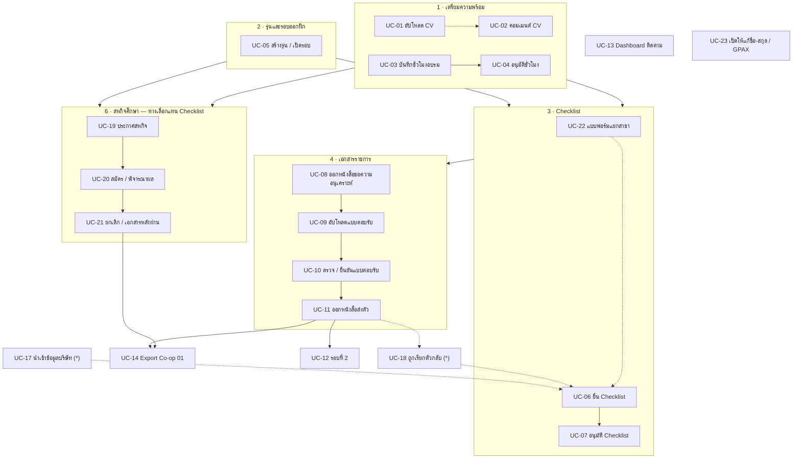

# 03 · ขั้นตอนการใช้งาน (Use Cases)

> เรียง Use Case ตามลำดับเวลาที่เกิดขึ้นจริง ตั้งแต่เตรียมความพร้อมจนออกหนังสือส่งตัว
> **หน้าจอ Demo** = หน้าที่จะคลิกให้ดูในวันประชุม · **BR-xx** = กฎใน [01_BUSINESS_RULES.md](01_BUSINESS_RULES.md)

## ภาพรวม

> เส้นประจาก UC-01 → UC-02: อาจารย์คอมเมนต์ได้ แต่ **ไม่ใช่เงื่อนไข** — อัปโหลด CV แล้วผ่านส่วน CV ทันที

## รายการ Use Case ทั้งหมด

| รหัส | ชื่อ | ผู้ใช้หลัก | สถานะ |
|---|---|---|:---:|
| UC-01 | อัปโหลด / แก้ไข CV | นิสิต | ✅ |
| UC-02 | คอมเมนต์ CV (ไม่มีการอนุมัติ) | อ.ที่ปรึกษา, อ.ประจำวิชา | ✅ |
| UC-03 | บันทึกชั่วโมงอบรม | นิสิต | ✅ |
| UC-04 | อนุมัติชั่วโมงอบรม | อ.ประจำวิชา | ✅ |
| UC-05 | สร้างรุ่น และเปิด/ปิดรอบออกฝึกรายสาขา | เจ้าหน้าที่ | ✅ |
| UC-06 | ยื่น Checklist สถานประกอบการ | นิสิต | ✅ |
| UC-07 | อนุมัติ / ตีกลับ Checklist | อ.ที่ปรึกษา | ✅ |
| UC-08 | ออกหนังสือขอความอนุเคราะห์ | เจ้าหน้าที่ | ✅ |
| UC-09 | อัปโหลดแบบตอบรับ | นิสิต | ✅ |
| UC-10 | ตรวจและยืนยันแบบตอบรับ | อ.ที่ปรึกษา, เจ้าหน้าที่ | ✅ |
| UC-11 | ออกหนังสือส่งตัว | เจ้าหน้าที่ | ✅ |
| UC-12 | ฝึกงานรอบที่ 2 / นิสิตตกค้าง | นิสิต, เจ้าหน้าที่ | ✅ |
| UC-13 | ติดตามสถานะผ่าน Dashboard | อ.ที่ปรึกษา, อ.ประจำวิชา, เจ้าหน้าที่, ผู้บริหาร | 🔴 (\*) |
| UC-14 | Export Co-op 01 ส่งระบบกลาง | เจ้าหน้าที่ | 🔴 (\*) |
| UC-15 | นำเข้ารายชื่อนิสิตและกำหนดอาจารย์ที่ปรึกษา | อ.ประจำวิชา, เจ้าหน้าที่ | ✅ |
| UC-16 | ⏸ ลงทะเบียนอบรม / สแกน QR เช็คอิน | นิสิต, เจ้าหน้าที่ | 🔴 (\*) |
| UC-17 | นำเข้าข้อมูลบริษัทจากไฟล์ (ควบคู่การกรอกเอง) | เจ้าหน้าที่ | 🔴 (\*) |
| UC-18 | บันทึกนิสิตถูกเรียกตัวกลับ / ยุติการฝึก | เจ้าหน้าที่, นิสิต | 🔴 (\*) |
| UC-19 | ประกาศรับนิสิตสหกิจศึกษา | เจ้าหน้าที่ (จัดการ), นิสิต (ดู) | ✅ |
| UC-20 | สมัครสหกิจศึกษา และติดตามผล | นิสิต, เจ้าหน้าที่ | ✅ |
| UC-21 | ยกเลิกใบสมัคร · เอกสารหลังผ่าน · Export · หน้าอาจารย์ | นิสิต, เจ้าหน้าที่, อ.ที่ปรึกษา (ดู) | ✅ |
| UC-22 | แบบฟอร์มการเลือกสถานประกอบการแยกตามสาขา | เจ้าหน้าที่ | ✅ |
| UC-23 | เปิดให้นิสิตแก้ไขชื่อ-สกุล / GPAX (1 ครั้ง) | อ.ประจำวิชา, นิสิต | ✅ |

---

## รายละเอียด Use Case

### UC-01 · อัปโหลด / แก้ไข CV
- **ผู้ใช้:** นิสิต
- **เงื่อนไขก่อนเริ่ม:** เข้าสู่ระบบแล้ว และกรอกข้อมูลส่วนตัวแล้ว
- **ขั้นตอนหลัก:**
  1. นิสิตเปิดหน้า CV
  2. อัปโหลดไฟล์ PDF
  3. ระบบบันทึกไฟล์ (สถานะ "อัปโหลดแล้ว รอคอมเมนต์") — ผ่านเงื่อนไขส่วน CV ทันที ไม่ต้องรออนุมัติ
  4. เมื่ออาจารย์คอมเมนต์ เมนู Resume (CV) ขึ้นป้าย "มีคอมเมนต์ใหม่" นิสิตเปิดอ่านได้ (ตอบกลับไม่ได้)
- **กรณีอื่น:** ช่วงที่กำลังฝึกงาน ระบบล็อกไม่ให้แก้ไข และแสดงข้อความแจ้ง (BR-14) · อัปโหลดไฟล์ใหม่ คอมเมนต์เดิมยังอยู่ (ติดป้าย "เขียนถึงไฟล์ก่อนหน้า")
- **หน้าจอ Demo:** หน้า CV ของนิสิต

### UC-02 · คอมเมนต์ CV (ไม่มีการอนุมัติ)
- **ผู้ใช้:** อาจารย์ที่ปรึกษา (เฉพาะนิสิตของตน) · อาจารย์ประจำวิชา · เจ้าหน้าที่ดูอย่างเดียว
- **ขั้นตอนหลัก:**
  1. อาจารย์เปิด Dashboard → ตัวกรอง "อัปโหลดแล้ว รอคอมเมนต์" เพื่อดูว่าควรดูของใครก่อน
  2. เลือกนิสิต → Profile นิสิต → การ์ด "เรซูเม่ / ใบ CV"
  3. เปิดดู CV แล้วพิมพ์คอมเมนต์ (≤ 2,000 ตัวอักษร) → นิสิตเห็นในหน้า Resume (CV)
- **กรณีอื่น:** ลบคอมเมนต์ของตัวเองได้ · นิสิตอัปโหลดไฟล์ใหม่หลังคอมเมนต์ → ระบบแจ้ง "อัปโหลดใหม่หลังคอมเมนต์ล่าสุด" และกลับเป็น "รอคอมเมนต์"
- **กฎที่เกี่ยวข้อง:** BR-10
- **หน้าจอ Demo:** Dashboard อาจารย์ที่ปรึกษา

### UC-03 · บันทึกชั่วโมงอบรม
- **ผู้ใช้:** นิสิต
- **ขั้นตอนหลัก:**
  1. นิสิตเพิ่มรายการอบรม (ชื่อกิจกรรม, ประเภท Soft/Hard, จำนวนชั่วโมง, **หน่วยงานผู้จัด**, **ลิงก์ประชาสัมพันธ์/ลงทะเบียน**)
  2. แนบใบประกาศ
  3. ระบบแสดงชั่วโมงสะสมเทียบกับเกณฑ์ 12/18
- **กรณีอื่น:** ช่วงที่กำลังฝึกงาน ระบบล็อกไม่ให้แก้ไข (BR-14) · กรอกผู้จัด/ลิงก์ไม่ครบ หรือลิงก์ไม่ขึ้นต้น http/https → บันทึกไม่ได้ · รายการที่ยังไม่ผ่านการตรวจ กด "แก้ไข" ได้ (รายการเก่าต้องกรอกผู้จัด/ลิงก์ให้ครบ) แล้วกลับเป็น "รอตรวจ"
- **กฎที่เกี่ยวข้อง:** BR-11, BR-13, BR-14.1
- **หน้าจอ Demo:** หน้าชั่วโมงอบรม และหน้าสถานะรวมของนิสิต

### UC-04 · อนุมัติชั่วโมงอบรม
- **ผู้ใช้:** อาจารย์ประจำวิชา (อนุมัติ) · อาจารย์ที่ปรึกษา / เจ้าหน้าที่ (ดูอย่างเดียว)
- **ขั้นตอนหลัก:**
  1. Profile นิสิต → ตารางชั่วโมงอบรม (คอลัมน์และหน้าตาเดียวกับหน้านิสิต: ชื่อ / ประเภท / ชั่วโมง / แหล่งที่มา / สถานะ / จัดการ)
  2. กด 👁 ดูรายละเอียด → เห็นหน่วยงานผู้จัด ลิงก์ประชาสัมพันธ์/ลงทะเบียน (เปิดแท็บใหม่) และรูป Certificate (กดขยายได้)
  3. อนุมัติ: กด "ผ่าน" / "ไม่ผ่าน" ในหน้าต่างรายละเอียด (ไม่ผ่านต้องใส่เหตุผล) หรือติ๊กหลายรายการแล้วบันทึกพร้อมกัน
- **กรณีอื่น:** รายการกิจกรรมคณะ/Check-in/นำเข้า เปลี่ยนสถานะไม่ได้ · อาจารย์ที่ปรึกษาไม่มีช่องติ๊ก/ปุ่มตัดสิน
- **หน้าจอ Demo:** หน้า Profile นิสิต (ฝั่งอาจารย์)

### UC-05 · สร้างรุ่น และเปิด/ปิดรอบออกฝึกรายสาขา
- **ผู้ใช้:** เจ้าหน้าที่ฝ่ายฝึกงาน
- **ขั้นตอนหลัก:**
  1. สร้างรุ่นใหม่ เช่น รุ่น 68 (คัดลอกรอบจากรุ่นก่อนได้ โดยระบบเลื่อนปีให้อัตโนมัติ)
  2. กำหนดรอบของแต่ละสาขา: เทอม, วันเปิด, วันปิด, วันสิ้นสุดการฝึก, รอบปกติหรือ Summer
  3. กด "ปลดล็อก" ให้นิสิตเริ่มยื่น Checklist
- **กรณีอื่น:**
  - เลยวันปิด → ระบบล็อกให้อัตโนมัติ เจ้าหน้าที่สั่ง "เปิดต่อพิเศษ" ได้ (BR-22)
  - กด "จบรอบ" เมื่อการฝึกเสร็จสิ้น (BR-23)
  - **ปิดรุ่น** → เลือกปีการศึกษาที่จบกระบวนการ (BR-04.1) + ระบบแสดงรายชื่อนิสิตที่ยังไม่ได้หนังสือส่งตัวให้ตรวจก่อน แล้วตั้งเป็น "ตกค้าง" (BR-54)
  - **เปิดรุ่นกลับมาใช้งาน** → ระบบแจ้งจำนวนนิสิตที่จะคืนสถานะปกติก่อนยืนยัน (BR-54.1)
- **หน้าจอ Demo:** หน้าผู้ดูแล → แท็บ "รอบฝึกงาน & ปลดล็อก"

### UC-06 · ยื่น Checklist สถานประกอบการ
- **ผู้ใช้:** นิสิต
- **เงื่อนไขก่อนเริ่ม:** สาขาของนิสิตมีรอบที่เปิดอยู่ (BR-20)
- **ขั้นตอนหลัก:**
  1. กรอกข้อมูลบริษัทและตำแหน่งงาน (ค้นหาตำแหน่งจากรายการมาตรฐานได้)
  2. ตอบแบบฟอร์มการเลือกสถานประกอบการของสาขาตัวเอง (ไม่มีแบบฟอร์มเฉพาะสาขา = แบบฟอร์มกลาง · UC-22)
  3. กดส่ง ระบบผูกนิสิตกับรอบออกฝึกให้อัตโนมัติ (BR-24)
- **กรณีอื่น:**
  - รอบยังปิดอยู่ → ยื่นไม่ได้ ระบบแสดงข้อความแจ้ง
  - เปิดหลายรอบพร้อมกัน หรือเป็นนิสิตตกค้าง → นิสิตเลือกรอบเอง
  - ยื่นได้ครั้งละ 1 บริษัทเท่านั้น (BR-30)
- **หน้าจอ Demo:** หน้า Checklist ของนิสิต

### UC-07 · อนุมัติ / ตีกลับ Checklist
- **ผู้ใช้:** อาจารย์ที่ปรึกษา **ของนิสิตคนนั้นเท่านั้น** (BR-32)
- **ขั้นตอนหลัก:**
  1. อาจารย์เปิดรายการ Checklist ที่รอตรวจ
  2. อ่านข้อมูลบริษัทและคำตอบ
  3. กดอนุมัติ หรือตีกลับพร้อมความเห็น
- **กรณีอื่น:** ถ้าตีกลับ นิสิตแก้ไขแล้วส่งใหม่ได้
- **ประเด็นต้องเคาะ:** 🔴 (\*) จะแจ้งเตือนอาจารย์ช่องทางใด เมื่อมี Checklist ใหม่ (OI-06)
- **หน้าจอ Demo:** หน้าตรวจ Checklist ของอาจารย์

### UC-08 · ออกหนังสือขอความอนุเคราะห์
- **ผู้ใช้:** เจ้าหน้าที่ฝ่ายฝึกงาน
- **เงื่อนไขก่อนเริ่ม:** Checklist ได้รับอนุมัติแล้ว
- **ขั้นตอนหลัก:**
  1. เจ้าหน้าที่เปิด "คิวออกหนังสือ" ซึ่งจัดกลุ่มตามบริษัท และกรองตามรุ่น สาขา รอบออกฝึก หรือสถานะได้
  2. เลือกบริษัท → กด "ออกหนังสือขอความอนุเคราะห์" ระบบรวมนิสิตที่ "รอออกหนังสือ" ของบริษัทนั้นทั้งหมด
  3. ระบุเลขที่หนังสือ → ระบบบันทึกเป็น **ฉบับใหม่** พร้อมรายชื่อ ณ วันที่ออก (หน้าสุดท้ายของหนังสือ) และแบบตอบรับเปล่า
  4. ดาวน์โหลดเป็น PDF · นิสิตในฉบับดาวน์โหลดหนังสือฉบับเดียวกัน (เห็นรายชื่อทุกคนรวมถึงตัวเอง)
- **กรณีอื่น:**
  - มีนิสิตยื่นบริษัทเดิมเพิ่มภายหลัง → ออกฉบับใหม่ที่มีเฉพาะคนใหม่ (BR-46)
  - นิสิตในฉบับถูกปฏิเสธภายหลัง → หนังสือฉบับเดิมยังมีชื่อครบ (BR-45)
  - 🔴 (\*) เลขที่หนังสือและกำหนดเวลาออก (ก่อนวันสัมภาษณ์ 1 วัน) รอยืนยัน (OI-09)
  - 🔴 (\*) ช่องทางส่ง: ใช้วิธีเดิมไปก่อน — เจ้าหน้าที่ส่งให้บริษัท นิสิตดาวน์โหลดสำเนาได้ (BR-49, OI-09)
  - 🔴 (\*) ลายเซ็นรองคณบดีแบบสแกน ต้องได้รับอนุญาตก่อน (BR-64, OI-12)
- **หน้าจอ Demo:** หน้าผู้ดูแล → แท็บ "คิวออกหนังสือ"

### UC-09 · อัปโหลดแบบตอบรับ
- **ผู้ใช้:** นิสิต
- **ขั้นตอนหลัก:** นิสิตอัปโหลดแบบตอบรับที่บริษัทกรอกแล้ว
- **หน้าจอ Demo:** หน้าสถานะรวมของนิสิต

### UC-10 · ตรวจและยืนยันแบบตอบรับ
- **ผู้ใช้:** อาจารย์ที่ปรึกษา → เจ้าหน้าที่ฝ่ายฝึกงาน
- **ขั้นตอนหลัก:**
  1. อาจารย์ที่ปรึกษาตรวจแบบตอบรับ
  2. เจ้าหน้าที่ยืนยันผล โดยระบบวิเคราะห์แบบตอบรับอัตโนมัติ (OMR) ตรวจช่อง ☐ รับ / ☐ ไม่รับ และแสดงผลพร้อมความมั่นใจ (เจ้าหน้าที่เป็นผู้ยืนยันผลสุดท้าย)
- **กรณีอื่น:** บริษัทปฏิเสธ → เก็บเข้าประวัติ แล้วนิสิตกลับไปยื่น Checklist บริษัทใหม่ (BR-42)
- **หน้าจอ Demo:** คิวออกหนังสือ (ขั้นแบบตอบรับ)

### UC-11 · ออกหนังสือส่งตัว
- **ผู้ใช้:** เจ้าหน้าที่ฝ่ายฝึกงาน
- **เงื่อนไขก่อนเริ่ม:** บริษัทตอบรับแล้ว
- **ขั้นตอนหลัก:** เจ้าหน้าที่กด "ออกหนังสือส่งตัว" ที่บริษัท → ระบบออกเป็นฉบับรายบริษัท แนบรายชื่อเฉพาะนิสิตที่แบบตอบรับยืนยันว่า "รับ" (BR-47) → ดาวน์โหลดเป็น PDF
- **ผลที่ตามมา:** นิสิตเข้าสู่สถานะ "กำลังฝึกงาน" และระบบล็อก CV/ชั่วโมงอบรมจนกว่าจะจบรอบ (BR-14)
- **หน้าจอ Demo:** คิวออกหนังสือ

### UC-12 · ฝึกงานรอบที่ 2 / นิสิตตกค้าง
- **ผู้ใช้:** นิสิต (และเจ้าหน้าที่ในกรณีตั้งสถานะตกค้าง)
- **ขั้นตอนหลัก:**
  1. นิสิตที่จบรอบที่ 1 กดเริ่มรอบที่ 2
  2. เลือก **"ฝึกที่เดิม"** หรือ **"เปลี่ยนที่ใหม่"**
  3. เลือกรอบออกฝึก (ถ้าเปิดรอบเดียว ระบบเลือกให้อัตโนมัติ)
- **ผลลัพธ์:**
  - ฝึกที่เดิม → เริ่มที่ขั้นหนังสือขอความอนุเคราะห์ (BR-52)
  - เปลี่ยนที่ใหม่ → เริ่ม Checklist ใหม่ (BR-53)
  - ประวัติรอบที่ 1 และชั่วโมงอบรมยังอยู่ครบ (BR-51, BR-13)
- **นิสิตตกค้าง:** เจ้าหน้าที่หรืออาจารย์ประจำวิชาตั้งสถานะในหน้ารายละเอียดนิสิต แล้วนิสิตยื่นรอบของรุ่นถัดไปได้ (BR-55)
- **ประเด็นต้องเคาะ:** 🔴 (\*) นิสิตตกค้างเปลี่ยนอาจารย์ที่ปรึกษาหรือไม่ (BR-57, OI-14)
- **หน้าจอ Demo:** Dashboard นิสิต และหน้ารายละเอียดนิสิต (ฝั่งผู้ดูแล)

### UC-13 · ติดตามสถานะผ่าน Dashboard
- **ผู้ใช้:** อาจารย์ที่ปรึกษา, อาจารย์ประจำวิชา, เจ้าหน้าที่, ผู้บริหาร
- **ขั้นตอนหลัก:** เปิด Dashboard → ดูจำนวนนิสิตแยกตามขั้นตอน → กรองตามรุ่น สาขา รอบออกฝึก หรือสถานะ → เปิดดูรายบุคคล
- **ประเด็นต้องเคาะ:** 🔴 (\*)
  - ผู้บริหารต้องการเห็นตัวเลขอะไรบ้าง
  - ต้องมีหน้าแยกหรือไม่ (OI-04)
  - อาจารย์ประจำวิชาเห็นเฉพาะสาขาตัวเองหรือไม่ (OI-03)
- **หน้าจอ Demo:** หน้าผู้ดูแล → แท็บ "ภาพรวม" และ Dashboard อาจารย์ที่ปรึกษา

### UC-14 · Export Co-op 01 ส่งระบบกลาง
- **ผู้ใช้:** เจ้าหน้าที่ฝ่ายฝึกงาน
- **ขั้นตอนหลัก:**
  1. เปิดแท็บ Co-op
  2. กรองตามรุ่น สาขา หรือรอบออกฝึก
  3. ตรวจรายชื่อ
  4. Export ไฟล์
- **ประเด็นต้องเคาะ:** 🔴 (\*) รูปแบบไฟล์และช่องข้อมูลที่ระบบกลางต้องการ (OI-07)
- **หน้าจอ Demo:** หน้าผู้ดูแล → แท็บ "Co-op"

### UC-15 · นำเข้ารายชื่อนิสิตและกำหนดอาจารย์ที่ปรึกษา
- **ผู้ใช้:** อาจารย์ประจำวิชา, เจ้าหน้าที่
- **ขั้นตอนหลัก:**
  1. อัปโหลดไฟล์ Excel
  2. ระบบแสดงตัวอย่างและปรับชื่อสาขาให้เป็นมาตรฐาน
  3. กดยืนยันการนำเข้า
  4. อาจารย์ประจำวิชากำหนดอาจารย์ที่ปรึกษาให้นิสิต
- **หน้าจอ Demo:** หน้าผู้ดูแล → แท็บ "ภาพรวม"

### UC-16 · ⏸ ลงทะเบียนอบรม / สแกน QR เช็คอิน (ระยะถัดไป)
- **ขอบเขตที่เสนอ:**
  - เปิดลงทะเบียน 3 วันก่อนกิจกรรม พร้อมโควตาที่นั่งจริงและที่นั่งสำรอง
  - สแกน QR ตอนเข้าและออกงาน เพื่อบันทึกชั่วโมงอัตโนมัติ
  - Export รายชื่อผู้เข้าอบรม
- **สถานะ:** 🔴 (\*) ยังไม่พัฒนา รอที่ประชุมตัดสินว่าอยู่ในขอบเขตหรือไม่ (OI-02)
- **ที่มีอยู่แล้ว:** เจ้าหน้าที่บันทึกผู้เข้าอบรมด้วยรหัสนิสิต (จากใบลงชื่อหน้างาน) ในแท็บ "กิจกรรมอบรม & Check-in"

### UC-17 · นำเข้าข้อมูลบริษัทจากไฟล์ (ร่าง — รอเคาะ)
- **ผู้ใช้:** เจ้าหน้าที่ฝ่ายฝึกงาน
- **ขั้นตอนหลัก (ที่เสนอ):**
  1. ดาวน์โหลดไฟล์แม่แบบ Excel/CSV
  2. กรอกข้อมูลบริษัท แล้วอัปโหลด
  3. ระบบแสดงตัวอย่าง และเตือนรายการที่ชื่อซ้ำกับบริษัทที่มีอยู่
  4. กดยืนยัน → บริษัทเข้าฐานข้อมูลด้วยสถานะ "คณะ ICT เป็นผู้เพิ่ม"
- **กรณีอื่น:** ยังกรอกเองทีละบริษัทได้เหมือนเดิม
- **กฎที่เกี่ยวข้อง:** BR-35 · 🔴 (\*) OI-15
- **หน้าจอ Demo:** หน้าผู้ดูแล → แท็บ "ฐานข้อมูลบริษัท" (ยังไม่มีปุ่มนำเข้า)

### UC-19 · ประกาศรับนิสิตสหกิจศึกษา (Phase 1 — ทำแล้ว)
- **ผู้ใช้:** เจ้าหน้าที่ฝ่ายฝึกงาน (จัดการประกาศ) · นิสิตทุกคน (ดูประกาศ)
- **ขั้นตอนหลัก (เจ้าหน้าที่):**
  1. หน้าผู้ดูแล → แท็บ "ประกาศสหกิจศึกษา" → "เพิ่มประกาศ" (พิมพ์ชื่อบริษัทแล้วเลือกจากฐานข้อมูลบริษัท ระบบเติมที่อยู่/HR ให้) หรือ "นำเข้าประกาศ (Excel)"
  2. เลือกจังหวัด และใส่ตำแหน่ง (เลือกจากตำแหน่งมาตรฐานหรือพิมพ์เอง / จำนวนที่รับ / ลักษณะงาน) — ไม่ต้องตั้งรอบเทอมหรือวันปิดรับ (ใช้ตามรอบออกฝึกของแต่ละสาขา) · เปิดรับทุกสาขา · GPAX ขั้นต่ำคงที่ 2.00
  3. นำเข้า Excel: ดาวน์โหลดไฟล์ตัวอย่าง → อัปโหลด → พรีวิว (ประกาศใหม่ / อัปเดตประกาศเดิม / แถวที่ข้าม) → บันทึก
- **ขั้นตอนหลัก (นิสิต):** แท็บ "สหกิจศึกษา" → แถบบอกรอบออกฝึกของตัวเอง (รอบ / วันปิดยื่น / ช่วงฝึก) → ตาราง 1 แถวต่อ 1 ตำแหน่ง → "ดูรายละเอียด" (คุณสมบัติ สวัสดิการ สถานที่) — ระบบเตือนถ้า GPAX ต่ำกว่า 2.00
- **กรณีอื่น:** ปิดรับ / เปิดรับอีกครั้ง · ลบประกาศ (กู้คืนไม่ได้)
- **กฎที่เกี่ยวข้อง:** BR-70 – BR-73
- **ต่อเนื่อง:** UC-20 (สมัคร) · UC-21 (ยกเลิก / เอกสารหลังผ่าน / Export / หน้าอาจารย์)

### UC-20 · สมัครสหกิจศึกษา และติดตามผล (Phase 2 — ทำแล้ว)
- **ผู้ใช้:** นิสิต (สมัคร) · เจ้าหน้าที่ฝ่ายฝึกงาน (ส่งเอกสาร/แจ้งผล)
- **เงื่อนไขก่อนเริ่ม:** อัปโหลด CV แล้ว + ชั่วโมงอบรมครบ + สาขาเปิดรอบออกฝึก · ยังไม่ได้ยื่นสถานประกอบการแบบฝึกงาน · ไม่มีใบสมัครสหกิจที่ยังไม่จบ
- **ขั้นตอนหลัก (นิสิต):**
  1. แท็บ "สหกิจศึกษา" → เลือกบริษัท → เลือกตำแหน่ง (หรือกด "สมัคร" ในตาราง/หน้ารายละเอียด ระบบเลือกให้)
  2. Resume: ใช้ไฟล์จากเมนู Resume (CV) หรืออัปโหลดใหม่ · แนบ Transcript (บังคับ) · Portfolio เป็นไฟล์หรือลิงก์ (ไม่บังคับ) — PDF/JPG/PNG ≤ 10 MB
  3. ยืนยัน → ระบบผูกรอบออกฝึก และล็อกเมนูสถานประกอบการ (เลือกได้ทางเดียว)
  4. ติดตามสถานะในแท็บเดียวกัน: ส่งใบสมัคร → คณะส่งเอกสารให้บริษัท → ผ่านการคัดเลือก
- **ขั้นตอนหลัก (เจ้าหน้าที่):** แท็บ "ประกาศสหกิจศึกษา" → การ์ด "ใบสมัครสหกิจศึกษา" → ดาวน์โหลด PDF รวม (Resume → Transcript → Portfolio) → เปลี่ยนสถานะทีละใบหรือเลือกหลายใบ
- **กรณีอื่น:** ไม่ผ่าน (ต้องใส่เหตุผล) → ใบสมัครเข้าประวัติ นิสิตสมัครสหกิจที่อื่นหรือไปยื่นสถานประกอบการแบบฝึกงานได้ · GPAX ต่ำกว่า 2.00 = แค่เตือน
- **กฎที่เกี่ยวข้อง:** BR-73 – BR-76.1 · ยกเลิก/เอกสารหลังผ่าน ดู UC-21

### UC-21 · ยกเลิกใบสมัคร · เอกสารหลังผ่าน · Export · หน้าอาจารย์ (Phase 3 — ทำแล้ว)
- **ผู้ใช้:** นิสิต (ยกเลิกเอง) · เจ้าหน้าที่ฝ่ายฝึกงาน (ยกเลิกแทน / ขั้นเอกสาร / Export) · อาจารย์ที่ปรึกษา (ดูอย่างเดียว)
- **ยกเลิก (นิสิต):** แท็บ "สหกิจศึกษา" → การ์ดใบสมัคร → "ยกเลิกใบสมัคร" (เฉพาะตอนส่งใบสมัครแล้ว) → ใส่เหตุผลหรือไม่ก็ได้ → ใบสมัครเข้าประวัติ เมนูสถานประกอบการปลดล็อก
- **ยกเลิก (เจ้าหน้าที่):** การ์ด "ใบสมัครสหกิจศึกษา" → เปลี่ยนสถานะ → "ยกเลิก" หรือเลือกหลายใบแล้วกด "ยกเลิกให้นิสิต" → ต้องใส่เหตุผล (ใช้ได้ทุกขั้น รวมหลังผ่าน)
- **เอกสารหลังผ่าน (เจ้าหน้าที่):** ใบที่ผ่านแล้ว → "เอกสารหลังผ่าน" → เลือกขั้น (ออกหนังสือขอความอนุเคราะห์ / ได้รับแบบตอบรับ / ออกหนังสือส่งตัว) + แนบไฟล์ (ไม่บังคับ) → นิสิตเห็นขั้นและเปิดไฟล์ได้ในแท็บสหกิจ
- **Export Co-op 01:** แท็บส่งออก Co-op 01 → ตัวกรอง "ฝึกงาน + สหกิจ / เฉพาะฝึกงาน / เฉพาะสหกิจศึกษา" → ไฟล์ CSV รูปแบบเดิม + คอลัมน์ "ประเภท" ท้ายไฟล์ (นิสิตสหกิจใช้ที่อยู่/จังหวัด/HR จากประกาศ)
- **อาจารย์ที่ปรึกษา:** รายชื่อนิสิตในความดูแลมีป้าย "🎓 สหกิจ: บริษัท · สถานะ" · หน้า Profile นิสิตมีการ์ด "สหกิจศึกษา" (สถานะ ขั้นเอกสาร ประวัติ) — อ่านอย่างเดียว
- **กฎที่เกี่ยวข้อง:** BR-77, BR-78

### UC-22 · แบบฟอร์มการเลือกสถานประกอบการแยกตามสาขา (ทำแล้ว)
- **ผู้ใช้:** เจ้าหน้าที่ฝ่ายฝึกงาน (แก้) · อาจารย์ประจำวิชา (ดูอย่างเดียว)
- **ขั้นตอนหลัก:**
  1. หน้าผู้ดูแล → แท็บ "แบบฟอร์มเลือกสถานประกอบการ" → ดูตาราง 8 สาขาว่าแต่ละสาขาใช้แบบฟอร์มชุดไหน
  2. "คัดลอกเป็นแบบฟอร์มใหม่" (หรือสร้างเปล่า) → ตั้งชื่อ → ติ๊กสาขาที่จะใช้ (ไม่ติ๊ก = แบบฟอร์มกลาง) → ได้ฉบับร่าง
  3. แก้หมวด / คำถาม (ลากสลับลำดับได้) → บันทึก
  4. "เปิดใช้งานแบบฟอร์มนี้" → ระบบแจ้งก่อนว่าสาขาไหนจะย้ายมาจากแบบฟอร์มเดิม → นิสิตสาขานั้นที่ยื่นใหม่ใช้แบบฟอร์มนี้ทันที
- **กรณีอื่น:** แบบฟอร์มที่เปิดใช้อยู่เพิ่ม/ลดสาขาได้ (สาขาที่เอาออกกลับไปใช้แบบฟอร์มกลาง) แต่เปลี่ยนประเภท กลาง ↔ เฉพาะสาขา ไม่ได้ — ให้คัดลอกเป็นแบบฟอร์มใหม่ · Checklist ที่ยื่นไปแล้วไม่เปลี่ยนตาม
- **กฎที่เกี่ยวข้อง:** BR-33 · 🔴 (\*) เนื้อหาแบบฟอร์มรายสาขา [OI-01](04_OPEN_ISSUES.md#oi-01)

### UC-23 · เปิดให้นิสิตแก้ไขชื่อ-สกุล / GPAX (ทำแล้ว — เพื่อนในทีมพัฒนา 25 พ.ย. 2569)
- **ผู้ใช้:** อาจารย์ประจำวิชา (เปิดสิทธิ์) · นิสิต (แก้ไข)
- **ที่มา:** ชื่อ-สกุล (ไทย/อังกฤษ) และ GPAX ดึงจากระบบทะเบียน (REG) จึงล็อกไว้ — กรณีข้อมูลผิด อาจารย์เปิดให้นิสิตแก้เองได้
- **ขั้นตอนหลัก:**
  1. อาจารย์ประจำวิชา: Dashboard → ติ๊กเลือกนิสิต (ได้หลายคน) → "เปิดให้แก้ไขข้อมูลส่วนตัว" → ยืนยัน → รายชื่อขึ้นป้าย "✏️ เปิดแก้ข้อมูลอยู่"
  2. นิสิต: หน้าข้อมูลส่วนตัวขึ้นแถบแจ้ง และช่อง ชื่อ-สกุล (ไทย/อังกฤษ) / GPAX แก้ได้
  3. นิสิตกดบันทึก → ระบบตรวจรูปแบบ (GPAX 0.00–4.00) → **ล็อกกลับอัตโนมัติ** (แก้ได้ 1 ครั้งต่อการเปิด 1 ครั้ง)
- **กรณีอื่น:** กดซ้ำกับนิสิตที่เปิดอยู่แล้ว = ล็อกกลับ (ยกเลิกสิทธิ์) · เลือกนิสิตนอกสาขาที่ดูแล = ข้าม · ชื่อภาษาอังกฤษที่ยังว่าง นิสิตกรอกครั้งแรกได้โดยไม่ต้องขอ
- **ข้อจำกัด:** สถานะการเปิดสิทธิ์เก็บในไฟล์ `data/super_admin_state.json` (ไม่มีตารางในฐานข้อมูล จึงไม่อยู่ใน ER) · ไม่เก็บประวัติค่าเดิมก่อนแก้
- **หน้าจอ Demo:** Dashboard อาจารย์ประจำวิชา → หน้าข้อมูลส่วนตัวของนิสิต

### UC-18 · บันทึกนิสิตถูกเรียกตัวกลับ / ยุติการฝึก (ร่าง — รอเคาะ)
- **ผู้ใช้:** เจ้าหน้าที่ฝ่ายฝึกงาน (บันทึก) → นิสิต (เริ่มใหม่)
- **เงื่อนไขก่อนเริ่ม:** นิสิตได้หนังสือส่งตัวแล้ว (กำลังฝึกงาน)
- **ขั้นตอนหลัก (ที่เสนอ):**
  1. เจ้าหน้าที่เปิดหน้ารายละเอียดนิสิต → กด "ยุติการฝึก"
  2. เลือกกรณี: (ก) คณะเรียกตัวกลับ หรือ (ข) บริษัทส่งตัวคืน และระบุเหตุผล
  3. ระบบเก็บสถานที่ฝึกเดิมเข้าประวัติ และปลดล็อก CV / ชั่วโมงอบรม
  4. นิสิตเริ่มยื่น Checklist บริษัทใหม่
- **ผลลัพธ์:** ประวัติและหนังสือที่ออกไปแล้วยังอยู่ (BR-45, BR-51) · ชั่วโมงอบรมคงอยู่ (BR-13)
- **ประเด็นต้องเคาะ:** 🔴 (\*) นับเป็นรอบที่ 2 หรือไม่, ใครเป็นผู้บันทึก, ต้องแจ้งระบบ Co-op กลางหรือไม่ (BR-56, OI-11)
