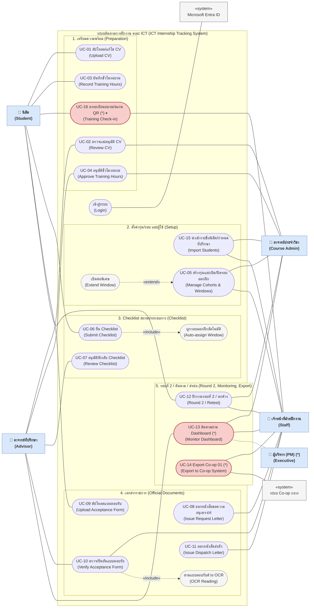

# 05 · Use Case Diagram (แผนภาพยูสเคส)

> แผนภาพรวมของ Use Case 16 ข้อใน [03_USE_CASES.md](../03_USE_CASES.md) · ผู้ใช้ 5 บทบาท + ระบบภายนอก 2 ระบบ
> ไฟล์ที่แก้ไขและ Export เป็นรูปได้: [use_case_diagram.drawio](use_case_diagram.drawio)
> อาจารย์นิเทศก์ยังไม่ใส่ในแผนภาพ — รอเคาะในที่ประชุม ([OI-04](../04_OPEN_ISSUES.md#oi-04))

## แผนภาพ

> **หมายเหตุ:** บน GitHub แผนภาพนี้จัดวางอัตโนมัติ เส้นอาจตัดกันบ้าง — ฉบับจัดวางสวยสำหรับสไลด์/เล่ม ให้ใช้ไฟล์ `.drawio` (สีเส้นแยกตามผู้ใช้)

## วิธีอ่าน

| สัญลักษณ์ | ความหมาย |
|---|---|
| 👤 รูปคน | ผู้ใช้ (Actor) |
| «system» | ระบบภายนอกที่เชื่อมต่อ |
| วงรี | Use Case (สิ่งที่ผู้ใช้ทำในระบบ) |
| เส้นทึบ | ผู้ใช้ทำ Use Case นั้นได้ |
| เส้นประ «include» | Use Case หลักเรียก Use Case ย่อยทุกครั้ง |
| เส้นประ «extend» | Use Case เสริมที่เกิดขึ้นเฉพาะบางกรณี |
| กรอบแดง (*) | ยังต้องเคาะในที่ประชุม — ดู [04_OPEN_ISSUES.md](../04_OPEN_ISSUES.md) |
| ⏸ | พักไว้ (ระยะถัดไป) |

## ผู้ใช้กับ Use Case (สรุป)

| ผู้ใช้ | Use Case |
|---|---|
| นิสิต | UC-01, 03, 06, 09, 12, 16 |
| อาจารย์ที่ปรึกษา | UC-02, 04, 07, 10, 13 |
| อาจารย์ประจำวิชา | UC-02, 04, 05, 12, 13, 15 |
| เจ้าหน้าที่ฝ่ายฝึกงาน | UC-05, 08, 10, 11, 12, 13, 14, 15, 16 |
| ผู้บริหาร (\*) | UC-13 |
| Microsoft Entra ID | เข้าสู่ระบบ |
| ระบบ Co-op กลาง | UC-14 |
