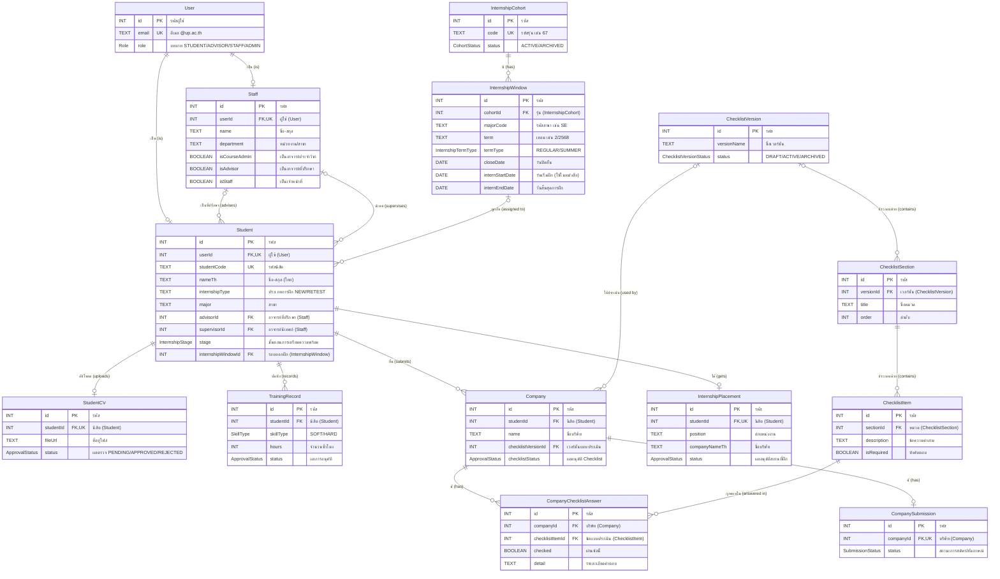

# 06 · ER Diagram (แผนภาพความสัมพันธ์ของข้อมูล)

> แผนภาพนี้สร้างจากฐานข้อมูลจริงของระบบ (`prisma/schema.prisma`) ณ วันที่ 16 พ.ย. 2569
> ไฟล์ที่แก้ไขได้: [er_diagram.drawio](er_diagram.drawio) (Crow's Foot) · [er_diagram_chen.drawio](er_diagram_chen.drawio) (Chen)
> ⚠️ โครงสร้างอาจเปลี่ยนหลังประชุมคณะ (เช่น ถ้าแต่ละสาขามีเกณฑ์ต่างกัน — [OI-01](../04_OPEN_ISSUES.md#oi-01))

## แผนภาพ (Crow's Foot)

แสดงเฉพาะคีย์และข้อมูลหลัก — รายละเอียดทุกคอลัมน์ดู [07_SCHEMA_DIAGRAM.md](07_SCHEMA_DIAGRAM.md)

**วิธีอ่านเส้นความสัมพันธ์:** `||` = หนึ่งเดียว · `o|` = ศูนย์หรือหนึ่ง · `o{` = ศูนย์หรือหลายรายการ

## Entity ทั้งหมด (14 ตาราง)

| Entity | ชื่อตาราง | จำนวนคอลัมน์ |
|---|---|:---:|
| บุคลากร | `Staff` | 8 |
| ผู้ใช้ | `User` | 6 |
| ชั่วโมงอบรม | `TrainingRecord` | 13 |
| CV นิสิต | `StudentCV` | 9 |
| นิสิต | `Student` | 28 |
| รอบออกฝึก | `InternshipWindow` | 18 |
| รุ่น | `InternshipCohort` | 8 |
| สถานที่ฝึกงาน | `InternshipPlacement` | 18 |
| บริษัทที่นิสิตยื่น | `Company` | 10 |
| เวอร์ชันแบบประเมิน | `ChecklistVersion` | 6 |
| สถานะการสมัครบริษัท | `CompanySubmission` | 4 |
| คำตอบแบบประเมิน | `CompanyChecklistAnswer` | 5 |
| ข้อแบบประเมิน | `ChecklistItem` | 7 |
| หมวดแบบประเมิน | `ChecklistSection` | 4 |

## ความสัมพันธ์ (Relationships)

| ฝั่งหลัก | ความสัมพันธ์ | ฝั่งย่อย | Cardinality |
|---|---|---|:---:|
| ผู้ใช้ (`User`) | เป็น (is) | นิสิต (`Student`) | 1 : 0..1 |
| ผู้ใช้ (`User`) | เป็น (is) | บุคลากร (`Staff`) | 1 : 0..1 |
| บุคลากร (`Staff`) | เป็นที่ปรึกษา (advises) | นิสิต (`Student`) | 0..1 : 0..* |
| บุคลากร (`Staff`) | นิเทศ (supervises) | นิสิต (`Student`) | 0..1 : 0..* |
| รุ่น (`InternshipCohort`) | มี (has) | รอบออกฝึก (`InternshipWindow`) | 1 : 0..* |
| รอบออกฝึก (`InternshipWindow`) | ผูกกับ (assigned to) | นิสิต (`Student`) | 0..1 : 0..* |
| นิสิต (`Student`) | อัปโหลด (uploads) | CV นิสิต (`StudentCV`) | 1 : 0..1 |
| นิสิต (`Student`) | บันทึก (records) | ชั่วโมงอบรม (`TrainingRecord`) | 1 : 0..* |
| นิสิต (`Student`) | ยื่น (submits) | บริษัทที่นิสิตยื่น (`Company`) | 1 : 0..* |
| นิสิต (`Student`) | ได้ (gets) | สถานที่ฝึกงาน (`InternshipPlacement`) | 1 : 0..1 |
| เวอร์ชันแบบประเมิน (`ChecklistVersion`) | ประกอบด้วย (contains) | หมวดแบบประเมิน (`ChecklistSection`) | 0..1 : 0..* |
| หมวดแบบประเมิน (`ChecklistSection`) | ประกอบด้วย (contains) | ข้อแบบประเมิน (`ChecklistItem`) | 1 : 0..* |
| เวอร์ชันแบบประเมิน (`ChecklistVersion`) | ใช้ประเมิน (used by) | บริษัทที่นิสิตยื่น (`Company`) | 0..1 : 0..* |
| บริษัทที่นิสิตยื่น (`Company`) | มี (has) | คำตอบแบบประเมิน (`CompanyChecklistAnswer`) | 1 : 0..* |
| ข้อแบบประเมิน (`ChecklistItem`) | ถูกตอบใน (answered in) | คำตอบแบบประเมิน (`CompanyChecklistAnswer`) | 1 : 0..* |
| บริษัทที่นิสิตยื่น (`Company`) | มี (has) | สถานะการสมัครบริษัท (`CompanySubmission`) | 1 : 0..1 |

## จุดที่ควรรู้

1. **ผู้ใช้ 1 คน เป็นได้ทั้ง "นิสิต" หรือ "บุคลากร"** — บุคลากรคนเดียวมีได้หลายหน้าที่พร้อมกัน (อาจารย์ที่ปรึกษา / อาจารย์ประจำวิชา / อาจารย์นิเทศก์ / เจ้าหน้าที่) ผ่านช่อง `isAdvisor`, `isCourseAdmin`, `isSupervisor`, `isStaff`
2. **รุ่น → รอบออกฝึก → นิสิต:** 1 รุ่น (เช่น 67) มีหลายรอบออกฝึก แยกตามสาขาและเทอม · นิสิตแต่ละคนผูกกับรอบที่กำลังใช้อยู่ 1 รอบ (ประวัติรอบก่อนหน้าเก็บแยก)
3. **แบบประเมิน Checklist มีเวอร์ชัน:** เวอร์ชัน → หมวด → ข้อคำถาม · บริษัทที่นิสิตยื่นจะผูกกับเวอร์ชันที่ใช้ตอนยื่น จึงแก้แบบประเมินได้โดยไม่กระทบคำตอบเก่า
4. **นิสิตยื่นได้หลายบริษัท (ตามเวลา)** แต่ระบบให้ดำเนินการทีละ 1 บริษัท และมีสถานที่ฝึกงานที่ยืนยันแล้วได้ 1 แห่ง

## ข้อมูลที่ยังไม่อยู่ในฐานข้อมูล (เก็บในไฟล์ JSON ชั่วคราว)

ข้อมูลต่อไปนี้ยังเก็บในไฟล์ `data/super_admin_state.json` และ **มีแผนย้ายเข้า PostgreSQL** ก่อนใช้งานจริง จึงยังไม่ปรากฏใน ER:

| ข้อมูล | ใช้ทำอะไร |
|---|---|
| สถานะเอกสารราชการรายนิสิต | หนังสือขอความอนุเคราะห์ / แบบตอบรับ / หนังสือส่งตัว |
| ข้อมูลบริษัทกลาง (Master Data) | รายชื่อบริษัทที่ตรวจสอบแล้ว |
| ประวัติรอบการฝึก (รอบที่ 1, 2) | เก็บประวัติรอบ 1 ไม่ให้หาย |
| ใบสมัครที่บริษัทปฏิเสธ (Archive) | ประวัติการยื่นบริษัท |
| กิจกรรมอบรมของคณะ | รายการกิจกรรมอบรม |
| การตั้งค่าปีการศึกษา / ผู้ลงนาม | ใช้ในหนังสือราชการ |
