# 06 · ER Diagram (แผนภาพความสัมพันธ์ของข้อมูล)

> แผนภาพนี้สร้างจากฐานข้อมูลจริงของระบบ (`prisma/schema.prisma`) ณ วันที่ 26 พ.ย. 2569 (เพิ่มสหกิจศึกษา · คอมเมนต์ CV · หน่วยงานผู้จัดใบรับรอง · แบบฟอร์มแยกสาขา)
> ไฟล์ที่แก้ไขได้: [er_diagram.drawio](er_diagram.drawio) (Crow's Foot) · [er_diagram_chen.drawio](er_diagram_chen.drawio) (Chen — หน้า 2 = สหกิจศึกษา + คอมเมนต์ CV)
> ⚠️ โครงสร้างอาจเปลี่ยนหลังประชุมคณะ (เช่น ถ้าแต่ละสาขามีเกณฑ์ต่างกัน — [OI-01](../04_OPEN_ISSUES.md#oi-01))

## แผนภาพ (Crow's Foot)

แสดงเฉพาะคีย์และข้อมูลหลัก — รายละเอียดทุกคอลัมน์ดู [07_SCHEMA_DIAGRAM.md](07_SCHEMA_DIAGRAM.md)

```mermaid
erDiagram
    User ||--o| Student : "เป็น (is)"
    User ||--o| Staff : "เป็น (is)"
    Staff |o--o{ Student : "เป็นที่ปรึกษา (advises)"
    Staff |o--o{ Student : "นิเทศ (supervises)"
    InternshipCohort ||--o{ InternshipWindow : "มี (has)"
    InternshipWindow |o--o{ Student : "ผูกกับ (assigned to)"
    Student ||--o| StudentCV : "อัปโหลด (uploads)"
    Student ||--o{ TrainingRecord : "บันทึก (records)"
    Student ||--o{ Company : "ยื่น (submits)"
    Student ||--o| InternshipPlacement : "ได้ (gets)"
    ChecklistVersion |o--o{ ChecklistSection : "ประกอบด้วย (contains)"
    ChecklistSection ||--o{ ChecklistItem : "ประกอบด้วย (contains)"
    ChecklistVersion |o--o{ Company : "ใช้ประเมิน (used by)"
    Company ||--o{ CompanyChecklistAnswer : "มี (has)"
    ChecklistItem ||--o{ CompanyChecklistAnswer : "ถูกตอบใน (answered in)"
    Company ||--o| CompanySubmission : "มี (has)"
    Student ||--o{ CvComment : "ได้รับคอมเมนต์ (receives)"
    CoopPosting ||--o{ CoopPosition : "มี (has)"
    Student ||--o{ CoopApplication : "สมัคร (applies)"
    CoopPosting ||--o{ CoopApplication : "ได้รับใบสมัคร (receives)"
    CoopPosition ||--o{ CoopApplication : "ถูกสมัคร (applied for)"
    InternshipWindow |o--o{ CoopApplication : "ผูกกับ (assigned to)"
    Staff {
        INT id PK "รหัส"
        INT userId FK,UK "ผู้ใช้ (User)"
        TEXT name "ชื่อ-สกุล"
        TEXT department "หน่วยงาน/สาขา"
        BOOLEAN isCourseAdmin "เป็นอาจารย์ประจำวิชา"
        BOOLEAN isAdvisor "เป็นอาจารย์ที่ปรึกษา"
        BOOLEAN isStaff "เป็นเจ้าหน้าที่"
    }
    User {
        INT id PK "รหัสผู้ใช้"
        TEXT email UK "อีเมล @up.ac.th"
        Role role "บทบาท STUDENT/ADVISOR/STAFF/ADMIN"
    }
    TrainingRecord {
        INT id PK "รหัส"
        INT studentId FK "นิสิต (Student)"
        SkillType skillType "SOFT/HARD"
        INT hours "จำนวนชั่วโมง"
        ApprovalStatus status "ผลการอนุมัติ (อาจารย์ประจำวิชา)"
        TEXT organizer "หน่วยงานผู้จัด"
        TEXT certificateLink "ลิงก์อ้างอิงใบรับรอง"
    }
    StudentCV {
        INT id PK "รหัส"
        INT studentId FK,UK "นิสิต (Student)"
        TEXT fileUrl "ที่อยู่ไฟล์"
        TIMESTAMP lastCommentAt "คอมเมนต์ล่าสุดของอาจารย์"
        TIMESTAMP commentsSeenAt "นิสิตอ่านคอมเมนต์ล่าสุด"
    }
    CvComment {
        INT id PK "รหัส"
        INT studentId FK "นิสิต (Student)"
        TEXT authorName "ผู้เขียน"
        TEXT authorRole "ADVISOR/COURSE_ADMIN"
        TEXT message "ข้อความ"
        TIMESTAMP createdAt "เวลาคอมเมนต์"
    }
    Student {
        INT id PK "รหัส"
        INT userId FK,UK "ผู้ใช้ (User)"
        TEXT studentCode UK "รหัสนิสิต"
        TEXT nameTh "ชื่อ-สกุล (ไทย)"
        TEXT internshipType "ประเภทการฝึก NEW/RETEST"
        TEXT major "สาขา"
        INT advisorId FK "อาจารย์ที่ปรึกษา (Staff)"
        INT supervisorId FK "อาจารย์นิเทศก์ (Staff)"
        InternshipStage stage "ขั้นตอนการเตรียมความพร้อม"
        INT internshipWindowId FK "รอบออกฝึก (InternshipWindow)"
    }
    InternshipWindow {
        INT id PK "รหัส"
        INT cohortId FK "รุ่น (InternshipCohort)"
        TEXT majorCode "รหัสสาขา เช่น SE"
        TEXT term "เทอม เช่น 2/2568"
        InternshipTermType termType "REGULAR/SUMMER"
        DATE closeDate "วันปิดยื่น"
        DATE internStartDate "วันเริ่มฝึก (ใช้ในหนังสือ)"
        DATE internEndDate "วันสิ้นสุดการฝึก"
    }
    InternshipCohort {
        INT id PK "รหัส"
        TEXT code UK "รหัสรุ่น เช่น 67"
        CohortStatus status "ACTIVE/ARCHIVED"
    }
    InternshipPlacement {
        INT id PK "รหัส"
        INT studentId FK,UK "นิสิต (Student)"
        TEXT position "ตำแหน่งงาน"
        TEXT companyNameTh "ชื่อบริษัท"
        ApprovalStatus status "ผลอนุมัติสถานที่ฝึก"
    }
    Company {
        INT id PK "รหัส"
        INT studentId FK "นิสิต (Student)"
        TEXT name "ชื่อบริษัท"
        INT checklistVersionId FK "เวอร์ชันแบบประเมิน"
        ApprovalStatus checklistStatus "ผลอนุมัติ Checklist"
    }
    ChecklistVersion {
        INT id PK "รหัส"
        TEXT versionName "ชื่อเวอร์ชัน"
        ChecklistVersionStatus status "DRAFT/ACTIVE/ARCHIVED"
        TEXT_ARRAY majorCodes "สาขาที่ใช้ (ว่าง = แบบฟอร์มกลาง)"
    }
    CoopPosting {
        INT id PK "รหัส"
        TEXT companyName "ชื่อบริษัท"
        TEXT province "จังหวัด"
        BOOLEAN isClosed "ปิดรับ"
    }
    CoopPosition {
        INT id PK "รหัส"
        INT postingId FK "ประกาศ (CoopPosting)"
        TEXT title "ชื่อตำแหน่ง"
        INT seats "จำนวนที่รับ"
    }
    CoopApplication {
        INT id PK "รหัส"
        INT studentId FK "นิสิต (Student)"
        INT postingId FK "ประกาศ (CoopPosting)"
        INT positionId FK "ตำแหน่ง (CoopPosition)"
        INT windowId FK "รอบออกฝึก (InternshipWindow)"
        CoopApplicationStatus status "SUBMITTED/SENT_TO_COMPANY/ACCEPTED/REJECTED/CANCELLED"
        CoopDocStep docStep "ขั้นเอกสารหลังผ่าน"
    }
    CompanySubmission {
        INT id PK "รหัส"
        INT companyId FK,UK "บริษัท (Company)"
        SubmissionStatus status "สถานะการสมัคร/สัมภาษณ์"
    }
    CompanyChecklistAnswer {
        INT id PK "รหัส"
        INT companyId FK "บริษัท (Company)"
        INT checklistItemId FK "ข้อแบบประเมิน (ChecklistItem)"
        BOOLEAN checked "ผ่านข้อนี้"
        TEXT detail "รายละเอียดคำตอบ"
    }
    ChecklistItem {
        INT id PK "รหัส"
        INT sectionId FK "หมวด (ChecklistSection)"
        TEXT description "ข้อความคำถาม"
        BOOLEAN isRequired "บังคับตอบ"
    }
    ChecklistSection {
        INT id PK "รหัส"
        INT versionId FK "เวอร์ชัน (ChecklistVersion)"
        TEXT title "ชื่อหมวด"
        INT order "ลำดับ"
    }
```

**วิธีอ่านเส้นความสัมพันธ์:** `||` = หนึ่งเดียว · `o|` = ศูนย์หรือหนึ่ง · `o{` = ศูนย์หรือหลายรายการ

## Entity ทั้งหมด (18 ตาราง)

| Entity | ชื่อตาราง | จำนวนคอลัมน์ |
|---|---|:---:|
| บุคลากร | `Staff` | 8 |
| ผู้ใช้ | `User` | 6 |
| ชั่วโมงอบรม | `TrainingRecord` | 15 |
| CV นิสิต | `StudentCV` | 11 |
| คอมเมนต์ CV | `CvComment` | 9 |
| นิสิต | `Student` | 29 |
| รอบออกฝึก | `InternshipWindow` | 18 |
| รุ่น | `InternshipCohort` | 10 |
| สถานที่ฝึกงาน | `InternshipPlacement` | 20 |
| บริษัทที่นิสิตยื่น | `Company` | 10 |
| เวอร์ชันแบบประเมิน (แบบฟอร์มการเลือกสถานประกอบการ) | `ChecklistVersion` | 7 |
| ประกาศสหกิจศึกษา | `CoopPosting` | 17 |
| ตำแหน่งที่เปิดรับ | `CoopPosition` | 6 |
| ใบสมัครสหกิจศึกษา | `CoopApplication` | 31 |
| สถานะการสมัครบริษัท | `CompanySubmission` | 4 |
| คำตอบแบบประเมิน | `CompanyChecklistAnswer` | 5 |
| ข้อแบบประเมิน | `ChecklistItem` | 7 |
| หมวดแบบประเมิน | `ChecklistSection` | 4 |

## ความสัมพันธ์ (Relationships)

| ฝั่งหลัก | ความสัมพันธ์ | ฝั่งย่อย | Cardinality |
|---|---|---|:---:|
| ผู้ใช้ (`User`) | เป็น (is) | นิสิต (`Student`) | 1 : 0..1 |
| ผู้ใช้ (`User`) | เป็น (is) | บุคลากร (`Staff`) | 1 : 0..1 |
| บุคลากร (`Staff`) | เป็นที่ปรึกษา (advises) | นิสิต (`Student`) | 0..1 : 0..* |
| บุคลากร (`Staff`) | นิเทศ (supervises) | นิสิต (`Student`) | 0..1 : 0..* |
| รุ่น (`InternshipCohort`) | มี (has) | รอบออกฝึก (`InternshipWindow`) | 1 : 0..* |
| รอบออกฝึก (`InternshipWindow`) | ผูกกับ (assigned to) | นิสิต (`Student`) | 0..1 : 0..* |
| นิสิต (`Student`) | อัปโหลด (uploads) | CV นิสิต (`StudentCV`) | 1 : 0..1 |
| นิสิต (`Student`) | บันทึก (records) | ชั่วโมงอบรม (`TrainingRecord`) | 1 : 0..* |
| นิสิต (`Student`) | ยื่น (submits) | บริษัทที่นิสิตยื่น (`Company`) | 1 : 0..* |
| นิสิต (`Student`) | ได้ (gets) | สถานที่ฝึกงาน (`InternshipPlacement`) | 1 : 0..1 |
| เวอร์ชันแบบประเมิน (`ChecklistVersion`) | ประกอบด้วย (contains) | หมวดแบบประเมิน (`ChecklistSection`) | 0..1 : 0..* |
| หมวดแบบประเมิน (`ChecklistSection`) | ประกอบด้วย (contains) | ข้อแบบประเมิน (`ChecklistItem`) | 1 : 0..* |
| เวอร์ชันแบบประเมิน (`ChecklistVersion`) | ใช้ประเมิน (used by) | บริษัทที่นิสิตยื่น (`Company`) | 0..1 : 0..* |
| บริษัทที่นิสิตยื่น (`Company`) | มี (has) | คำตอบแบบประเมิน (`CompanyChecklistAnswer`) | 1 : 0..* |
| ข้อแบบประเมิน (`ChecklistItem`) | ถูกตอบใน (answered in) | คำตอบแบบประเมิน (`CompanyChecklistAnswer`) | 1 : 0..* |
| บริษัทที่นิสิตยื่น (`Company`) | มี (has) | สถานะการสมัครบริษัท (`CompanySubmission`) | 1 : 0..1 |
| นิสิต (`Student`) | ได้รับคอมเมนต์ (receives) | คอมเมนต์ CV (`CvComment`) | 1 : 0..* |
| ประกาศสหกิจ (`CoopPosting`) | มี (has) | ตำแหน่งที่เปิดรับ (`CoopPosition`) | 1 : 0..* |
| นิสิต (`Student`) | สมัคร (applies) | ใบสมัครสหกิจ (`CoopApplication`) | 1 : 0..* |
| ประกาศสหกิจ (`CoopPosting`) | ได้รับใบสมัคร (receives) | ใบสมัครสหกิจ (`CoopApplication`) | 1 : 0..* |
| ตำแหน่งที่เปิดรับ (`CoopPosition`) | ถูกสมัคร (applied for) | ใบสมัครสหกิจ (`CoopApplication`) | 1 : 0..* |
| รอบออกฝึก (`InternshipWindow`) | ผูกกับ (assigned to) | ใบสมัครสหกิจ (`CoopApplication`) | 0..1 : 0..* |

## จุดที่ควรรู้

1. **ผู้ใช้ 1 คน เป็นได้ทั้ง "นิสิต" หรือ "บุคลากร"** — บุคลากรคนเดียวมีได้หลายหน้าที่พร้อมกัน (อาจารย์ที่ปรึกษา / อาจารย์ประจำวิชา / อาจารย์นิเทศก์ / เจ้าหน้าที่) ผ่านช่อง `isAdvisor`, `isCourseAdmin`, `isSupervisor`, `isStaff`
2. **รุ่น → รอบออกฝึก → นิสิต:** 1 รุ่น (เช่น 67) มีหลายรอบออกฝึก แยกตามสาขาและเทอม · นิสิตแต่ละคนผูกกับรอบที่กำลังใช้อยู่ 1 รอบ (ประวัติรอบก่อนหน้าเก็บแยก)
3. **แบบประเมิน Checklist มีเวอร์ชัน:** เวอร์ชัน → หมวด → ข้อคำถาม · บริษัทที่นิสิตยื่นจะผูกกับเวอร์ชันที่ใช้ตอนยื่น จึงแก้แบบประเมินได้โดยไม่กระทบคำตอบเก่า
4. **นิสิตยื่นได้หลายบริษัท (ตามเวลา)** แต่ระบบให้ดำเนินการทีละ 1 บริษัท และมีสถานที่ฝึกงานที่ยืนยันแล้วได้ 1 แห่ง
5. **แบบฟอร์มแยกตามสาขา:** `ChecklistVersion.majorCodes` บอกว่าแบบฟอร์มใช้กับสาขาไหน (ว่าง = แบบฟอร์มกลาง) — 1 สาขามีแบบฟอร์มที่เปิดใช้ได้ 1 ชุด
6. **CV ไม่มีการอนุมัติแล้ว (24 พ.ย. 2569):** `StudentCV.status` / `note` เลิกใช้ (ยังไม่ลบคอลัมน์) — อาจารย์คอมเมนต์ลง `CvComment` (เก็บทุกข้อความ) และ `lastCommentAt` / `commentsSeenAt` ใช้แสดงป้าย "รอคอมเมนต์" / "มีคอมเมนต์ใหม่"
7. **สหกิจศึกษา:** ประกาศ 1 ใบมีหลายตำแหน่ง · ใบสมัครเก็บชื่อบริษัท/ตำแหน่ง ณ วันที่สมัครไว้ด้วย (กันประกาศถูกแก้ภายหลัง) · นิสิตเลือกได้ทางเดียว — ฝึกงาน (`Company`) **หรือ** สหกิจ (`CoopApplication`) — ระบบบังคับในโค้ด ไม่ใช่ที่ตาราง

## ข้อมูลที่ยังไม่อยู่ในฐานข้อมูล (เก็บในไฟล์ JSON ชั่วคราว)

ข้อมูลต่อไปนี้ยังเก็บในไฟล์ `data/super_admin_state.json` และ **มีแผนย้ายเข้า PostgreSQL** ก่อนใช้งานจริง จึงยังไม่ปรากฏใน ER:

| ข้อมูล | ใช้ทำอะไร |
|---|---|
| สถานะเอกสารราชการรายนิสิต | หนังสือขอความอนุเคราะห์ / แบบตอบรับ / หนังสือส่งตัว |
| ข้อมูลบริษัทกลาง (Master Data) | รายชื่อบริษัทที่ตรวจสอบแล้ว |
| ประวัติรอบการฝึก (รอบที่ 1, 2) | เก็บประวัติรอบ 1 ไม่ให้หาย |
| ใบสมัครที่บริษัทปฏิเสธ (Archive) | ประวัติการยื่นบริษัท |
| กิจกรรมอบรมของคณะ | รายการกิจกรรมอบรม |
| การตั้งค่าปีการศึกษา / ผู้ลงนาม | ใช้ในหนังสือราชการ |
| นิสิตที่เปิดให้แก้ชื่อ-สกุล / GPAX (`profileEditUnlocks`) | UC-23 — ล็อกกลับเมื่อนิสิตบันทึก (ไม่เก็บประวัติค่าเดิม) |
