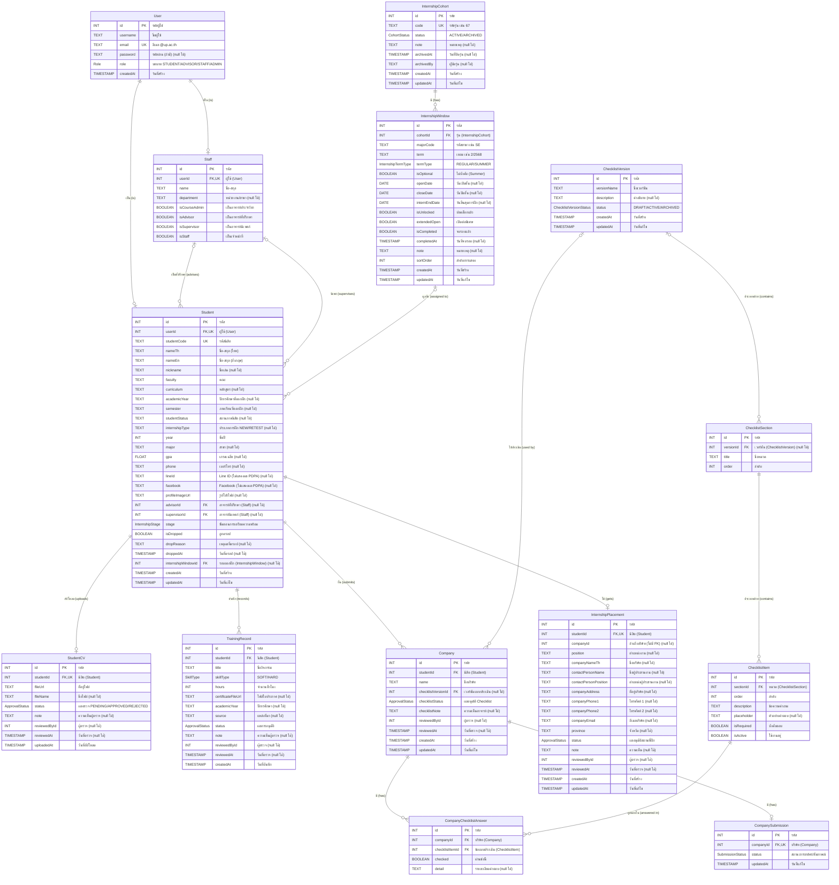

# 07 · Schema Diagram (โครงสร้างตารางในฐานข้อมูล)

> ตาราง คอลัมน์ ชนิดข้อมูล และคีย์ทั้งหมด ตาม `prisma/schema.prisma` (PostgreSQL) ณ วันที่ 16 พ.ย. 2569
> ไฟล์ที่แก้ไขได้: [schema_diagram.drawio](schema_diagram.drawio) · ไม่รวมตาราง `session` (ใช้เก็บการล็อกอิน)

## แผนภาพ

## ค่าคงที่ (Enum)

| Enum | ค่าที่เป็นไปได้ |
|---|---|
| `Role` | STUDENT, ADVISOR, STAFF, ADMIN |
| `InternshipStage` | PENDING_DOCUMENTS, PENDING_APPROVAL, READY |
| `CohortStatus` | ACTIVE (เปิดใช้งาน), ARCHIVED (ปิดรุ่นแล้ว) |
| `InternshipTermType` | REGULAR (ภาคปกติ), SUMMER (ภาคฤดูร้อน) |
| `ApprovalStatus` | PENDING (รอตรวจ), APPROVED (ผ่าน), REJECTED (ไม่ผ่าน) |
| `SkillType` | SOFT, HARD |
| `ChecklistVersionStatus` | DRAFT, ACTIVE, ARCHIVED |
| `SubmissionStatus` | NOT_SUBMITTED, SUBMITTED_WAITING, INTERVIEWED_PENDING, INTERVIEW_PASSED, INTERVIEW_FAILED_REAPPLIED |

## รายละเอียดแต่ละตาราง

### Staff — บุคลากร

| คอลัมน์ | ชนิด | คีย์ | Null | คำอธิบาย |
|---|---|:---:|:---:|---|
| `id` | INT | PK |  | รหัส |
| `userId` | INT | FK,UK |  | ผู้ใช้ (User) |
| `name` | TEXT |  |  | ชื่อ-สกุล |
| `department` | TEXT |  | ✓ | หน่วยงาน/สาขา |
| `isCourseAdmin` | BOOLEAN |  |  | เป็นอาจารย์ประจำวิชา |
| `isAdvisor` | BOOLEAN |  |  | เป็นอาจารย์ที่ปรึกษา |
| `isSupervisor` | BOOLEAN |  |  | เป็นอาจารย์นิเทศก์ |
| `isStaff` | BOOLEAN |  |  | เป็นเจ้าหน้าที่ |

### User — ผู้ใช้

| คอลัมน์ | ชนิด | คีย์ | Null | คำอธิบาย |
|---|---|:---:|:---:|---|
| `id` | INT | PK |  | รหัสผู้ใช้ |
| `username` | TEXT |  |  | ชื่อผู้ใช้ |
| `email` | TEXT | UK |  | อีเมล @up.ac.th |
| `password` | TEXT |  | ✓ | รหัสผ่าน (ถ้ามี) |
| `role` | Role |  |  | บทบาท STUDENT/ADVISOR/STAFF/ADMIN |
| `createdAt` | TIMESTAMP |  |  | วันที่สร้าง |

### TrainingRecord — ชั่วโมงอบรม

| คอลัมน์ | ชนิด | คีย์ | Null | คำอธิบาย |
|---|---|:---:|:---:|---|
| `id` | INT | PK |  | รหัส |
| `studentId` | INT | FK |  | นิสิต (Student) |
| `title` | TEXT |  |  | ชื่อกิจกรรม |
| `skillType` | SkillType |  |  | SOFT/HARD |
| `hours` | INT |  |  | จำนวนชั่วโมง |
| `certificateFileUrl` | TEXT |  | ✓ | ไฟล์ใบประกาศ |
| `academicYear` | TEXT |  | ✓ | ปีการศึกษา |
| `source` | TEXT |  | ✓ | แหล่งที่มา |
| `status` | ApprovalStatus |  |  | ผลการอนุมัติ |
| `note` | TEXT |  | ✓ | ความเห็นผู้ตรวจ |
| `reviewedById` | INT |  | ✓ | ผู้ตรวจ |
| `reviewedAt` | TIMESTAMP |  | ✓ | วันที่ตรวจ |
| `createdAt` | TIMESTAMP |  |  | วันที่บันทึก |

### StudentCV — CV นิสิต

| คอลัมน์ | ชนิด | คีย์ | Null | คำอธิบาย |
|---|---|:---:|:---:|---|
| `id` | INT | PK |  | รหัส |
| `studentId` | INT | FK,UK |  | นิสิต (Student) |
| `fileUrl` | TEXT |  |  | ที่อยู่ไฟล์ |
| `fileName` | TEXT |  | ✓ | ชื่อไฟล์ |
| `status` | ApprovalStatus |  |  | ผลตรวจ PENDING/APPROVED/REJECTED |
| `note` | TEXT |  | ✓ | ความเห็นผู้ตรวจ |
| `reviewedById` | INT |  | ✓ | ผู้ตรวจ |
| `reviewedAt` | TIMESTAMP |  | ✓ | วันที่ตรวจ |
| `uploadedAt` | TIMESTAMP |  |  | วันที่อัปโหลด |

### Student — นิสิต

| คอลัมน์ | ชนิด | คีย์ | Null | คำอธิบาย |
|---|---|:---:|:---:|---|
| `id` | INT | PK |  | รหัส |
| `userId` | INT | FK,UK |  | ผู้ใช้ (User) |
| `studentCode` | TEXT | UK |  | รหัสนิสิต |
| `nameTh` | TEXT |  |  | ชื่อ-สกุล (ไทย) |
| `nameEn` | TEXT |  |  | ชื่อ-สกุล (อังกฤษ) |
| `nickname` | TEXT |  | ✓ | ชื่อเล่น |
| `faculty` | TEXT |  |  | คณะ |
| `curriculum` | TEXT |  | ✓ | หลักสูตร |
| `academicYear` | TEXT |  | ✓ | ปีการศึกษาที่ออกฝึก |
| `semester` | TEXT |  | ✓ | ภาคเรียนที่ออกฝึก |
| `studentStatus` | TEXT |  | ✓ | สถานภาพนิสิต |
| `internshipType` | TEXT |  | ✓ | ประเภทการฝึก NEW/RETEST |
| `year` | INT |  |  | ชั้นปี |
| `major` | TEXT |  | ✓ | สาขา |
| `gpa` | FLOAT |  | ✓ | เกรดเฉลี่ย |
| `phone` | TEXT |  | ✓ | เบอร์โทร |
| `lineId` | TEXT |  | ✓ | Line ID (ไม่แสดงผล PDPA) |
| `facebook` | TEXT |  | ✓ | Facebook (ไม่แสดงผล PDPA) |
| `profileImageUrl` | TEXT |  | ✓ | รูปโปรไฟล์ |
| `advisorId` | INT | FK | ✓ | อาจารย์ที่ปรึกษา (Staff) |
| `supervisorId` | INT | FK | ✓ | อาจารย์นิเทศก์ (Staff) |
| `stage` | InternshipStage |  |  | ขั้นตอนการเตรียมความพร้อม |
| `isDropped` | BOOLEAN |  |  | ถูกดรอป |
| `dropReason` | TEXT |  | ✓ | เหตุผลที่ดรอป |
| `droppedAt` | TIMESTAMP |  | ✓ | วันที่ดรอป |
| `internshipWindowId` | INT | FK | ✓ | รอบออกฝึก (InternshipWindow) |
| `createdAt` | TIMESTAMP |  |  | วันที่สร้าง |
| `updatedAt` | TIMESTAMP |  |  | วันที่แก้ไข |

### InternshipWindow — รอบออกฝึก

| คอลัมน์ | ชนิด | คีย์ | Null | คำอธิบาย |
|---|---|:---:|:---:|---|
| `id` | INT | PK |  | รหัส |
| `cohortId` | INT | FK |  | รุ่น (InternshipCohort) |
| `majorCode` | TEXT |  |  | รหัสสาขา เช่น SE |
| `term` | TEXT |  |  | เทอม เช่น 2/2568 |
| `termType` | InternshipTermType |  |  | REGULAR/SUMMER |
| `isOptional` | BOOLEAN |  |  | ไม่บังคับ (Summer) |
| `openDate` | DATE |  | ✓ | วันเปิดยื่น |
| `closeDate` | DATE |  | ✓ | วันปิดยื่น |
| `internEndDate` | DATE |  | ✓ | วันสิ้นสุดการฝึก |
| `isUnlocked` | BOOLEAN |  |  | ปลดล็อกแล้ว |
| `extendedOpen` | BOOLEAN |  |  | เปิดต่อพิเศษ |
| `isCompleted` | BOOLEAN |  |  | จบรอบแล้ว |
| `completedAt` | TIMESTAMP |  | ✓ | วันที่จบรอบ |
| `note` | TEXT |  | ✓ | หมายเหตุ |
| `sortOrder` | INT |  |  | ลำดับการแสดง |
| `createdAt` | TIMESTAMP |  |  | วันที่สร้าง |
| `updatedAt` | TIMESTAMP |  |  | วันที่แก้ไข |

> ข้อจำกัด: `UNIQUE (cohortId, majorCode, term)`

### InternshipCohort — รุ่น

| คอลัมน์ | ชนิด | คีย์ | Null | คำอธิบาย |
|---|---|:---:|:---:|---|
| `id` | INT | PK |  | รหัส |
| `code` | TEXT | UK |  | รหัสรุ่น เช่น 67 |
| `status` | CohortStatus |  |  | ACTIVE/ARCHIVED |
| `note` | TEXT |  | ✓ | หมายเหตุ |
| `archivedAt` | TIMESTAMP |  | ✓ | วันที่ปิดรุ่น |
| `archivedBy` | TEXT |  | ✓ | ผู้ปิดรุ่น |
| `createdAt` | TIMESTAMP |  |  | วันที่สร้าง |
| `updatedAt` | TIMESTAMP |  |  | วันที่แก้ไข |

### InternshipPlacement — สถานที่ฝึกงาน

| คอลัมน์ | ชนิด | คีย์ | Null | คำอธิบาย |
|---|---|:---:|:---:|---|
| `id` | INT | PK |  | รหัส |
| `studentId` | INT | FK,UK |  | นิสิต (Student) |
| `companyId` | INT |  | ✓ | อ้างถึงบริษัท (ไม่มี FK) |
| `position` | TEXT |  | ✓ | ตำแหน่งงาน |
| `companyNameTh` | TEXT |  | ✓ | ชื่อบริษัท |
| `contactPersonName` | TEXT |  | ✓ | ชื่อผู้ประสานงาน |
| `contactPersonPosition` | TEXT |  | ✓ | ตำแหน่งผู้ประสานงาน |
| `companyAddress` | TEXT |  | ✓ | ที่อยู่บริษัท |
| `companyPhone1` | TEXT |  | ✓ | โทรศัพท์ 1 |
| `companyPhone2` | TEXT |  | ✓ | โทรศัพท์ 2 |
| `companyEmail` | TEXT |  | ✓ | อีเมลบริษัท |
| `province` | TEXT |  | ✓ | จังหวัด |
| `status` | ApprovalStatus |  |  | ผลอนุมัติสถานที่ฝึก |
| `note` | TEXT |  | ✓ | ความเห็น |
| `reviewedById` | INT |  | ✓ | ผู้ตรวจ |
| `reviewedAt` | TIMESTAMP |  | ✓ | วันที่ตรวจ |
| `createdAt` | TIMESTAMP |  |  | วันที่สร้าง |
| `updatedAt` | TIMESTAMP |  |  | วันที่แก้ไข |

### Company — บริษัทที่นิสิตยื่น

| คอลัมน์ | ชนิด | คีย์ | Null | คำอธิบาย |
|---|---|:---:|:---:|---|
| `id` | INT | PK |  | รหัส |
| `studentId` | INT | FK |  | นิสิต (Student) |
| `name` | TEXT |  |  | ชื่อบริษัท |
| `checklistVersionId` | INT | FK | ✓ | เวอร์ชันแบบประเมิน |
| `checklistStatus` | ApprovalStatus |  |  | ผลอนุมัติ Checklist |
| `checklistNote` | TEXT |  | ✓ | ความเห็นอาจารย์ |
| `reviewedById` | INT |  | ✓ | ผู้ตรวจ |
| `reviewedAt` | TIMESTAMP |  | ✓ | วันที่ตรวจ |
| `createdAt` | TIMESTAMP |  |  | วันที่สร้าง |
| `updatedAt` | TIMESTAMP |  |  | วันที่แก้ไข |

### ChecklistVersion — เวอร์ชันแบบประเมิน

| คอลัมน์ | ชนิด | คีย์ | Null | คำอธิบาย |
|---|---|:---:|:---:|---|
| `id` | INT | PK |  | รหัส |
| `versionName` | TEXT |  |  | ชื่อเวอร์ชัน |
| `description` | TEXT |  | ✓ | คำอธิบาย |
| `status` | ChecklistVersionStatus |  |  | DRAFT/ACTIVE/ARCHIVED |
| `createdAt` | TIMESTAMP |  |  | วันที่สร้าง |
| `updatedAt` | TIMESTAMP |  |  | วันที่แก้ไข |

### CompanySubmission — สถานะการสมัครบริษัท

| คอลัมน์ | ชนิด | คีย์ | Null | คำอธิบาย |
|---|---|:---:|:---:|---|
| `id` | INT | PK |  | รหัส |
| `companyId` | INT | FK,UK |  | บริษัท (Company) |
| `status` | SubmissionStatus |  |  | สถานะการสมัคร/สัมภาษณ์ |
| `updatedAt` | TIMESTAMP |  |  | วันที่แก้ไข |

### CompanyChecklistAnswer — คำตอบแบบประเมิน

| คอลัมน์ | ชนิด | คีย์ | Null | คำอธิบาย |
|---|---|:---:|:---:|---|
| `id` | INT | PK |  | รหัส |
| `companyId` | INT | FK |  | บริษัท (Company) |
| `checklistItemId` | INT | FK |  | ข้อแบบประเมิน (ChecklistItem) |
| `checked` | BOOLEAN |  |  | ผ่านข้อนี้ |
| `detail` | TEXT |  | ✓ | รายละเอียดคำตอบ |

> ข้อจำกัด: `UNIQUE (companyId, checklistItemId)`

### ChecklistItem — ข้อแบบประเมิน

| คอลัมน์ | ชนิด | คีย์ | Null | คำอธิบาย |
|---|---|:---:|:---:|---|
| `id` | INT | PK |  | รหัส |
| `sectionId` | INT | FK |  | หมวด (ChecklistSection) |
| `order` | INT |  |  | ลำดับ |
| `description` | TEXT |  |  | ข้อความคำถาม |
| `placeholder` | TEXT |  | ✓ | ตัวอย่างคำตอบ |
| `isRequired` | BOOLEAN |  |  | บังคับตอบ |
| `isActive` | BOOLEAN |  |  | ใช้งานอยู่ |

> ข้อจำกัด: `UNIQUE (sectionId, order)`

### ChecklistSection — หมวดแบบประเมิน

| คอลัมน์ | ชนิด | คีย์ | Null | คำอธิบาย |
|---|---|:---:|:---:|---|
| `id` | INT | PK |  | รหัส |
| `versionId` | INT | FK | ✓ | เวอร์ชัน (ChecklistVersion) |
| `title` | TEXT |  |  | ชื่อหมวด |
| `order` | INT |  |  | ลำดับ |

> ข้อจำกัด: `UNIQUE (versionId, order)`

