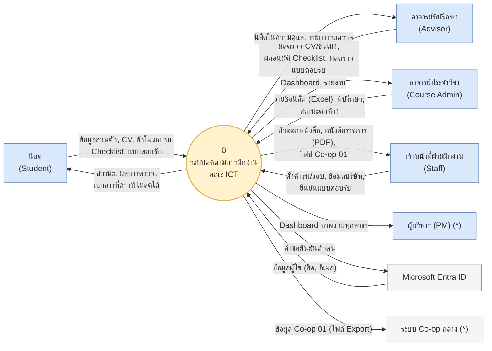
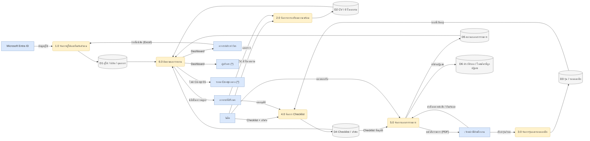

# 08 · Context Diagram และ DFD (แผนภาพการไหลของข้อมูล)

> ไฟล์ที่แก้ไขได้: [context_diagram.drawio](context_diagram.drawio) · [dfd_level1.drawio](dfd_level1.drawio)
> (\*) = ยังต้องเคาะในที่ประชุม

## 1. Context Diagram (DFD Level 0)

มองระบบทั้งระบบเป็นกล่องเดียว แสดงว่า **ใครส่งข้อมูลอะไรเข้า และได้อะไรออกไป**

> **สถานประกอบการ** ไม่ได้ใช้ระบบโดยตรง — รับหนังสือและส่งแบบตอบรับผ่านนิสิต/เจ้าหน้าที่ จึงไม่อยู่ในแผนภาพ

## 2. DFD Level 1

แตกระบบออกเป็น **6 กระบวนการหลัก** และ **6 แหล่งเก็บข้อมูล**

### กระบวนการ (Processes)

| รหัส | กระบวนการ | Use Case ที่เกี่ยวข้อง |
|---|---|---|
| 1.0 | จัดการผู้ใช้และยืนยันตัวตน (Users & Authentication) | เข้าสู่ระบบ, UC-15 |
| 2.0 | จัดการการเตรียมความพร้อม (Manage Preparation) | UC-01 – UC-04 |
| 3.0 | จัดการรุ่นและรอบออกฝึก (Manage Cohorts & Windows) | UC-05, UC-12 |
| 4.0 | จัดการ Checklist (Manage Checklist) | UC-06, UC-07 |
| 5.0 | จัดการเอกสารราชการ (Manage Official Documents) | UC-08 – UC-11 |
| 6.0 | ติดตามและรายงาน (Monitor & Report) | UC-13, UC-14 |

### แหล่งเก็บข้อมูล (Data Stores)

| รหัส | ข้อมูล | ตารางในฐานข้อมูล |
|---|---|---|
| D1 | ผู้ใช้ / นิสิต / บุคลากร | `User`, `Student`, `Staff` |
| D2 | CV / ชั่วโมงอบรม | `StudentCV`, `TrainingRecord` |
| D3 | รุ่น / รอบออกฝึก | `InternshipCohort`, `InternshipWindow` |
| D4 | Checklist / บริษัท | `ChecklistVersion`, `ChecklistSection`, `ChecklistItem`, `Company`, `CompanyChecklistAnswer`, `CompanySubmission`, `InternshipPlacement` |
| D5 | สถานะเอกสารราชการ | ปัจจุบันเก็บในไฟล์ JSON (มีแผนย้ายเข้า PostgreSQL) |
| D6 | ประวัติรอบ / ใบสมัครที่ถูกปฏิเสธ | ปัจจุบันเก็บในไฟล์ JSON (มีแผนย้ายเข้า PostgreSQL) |
