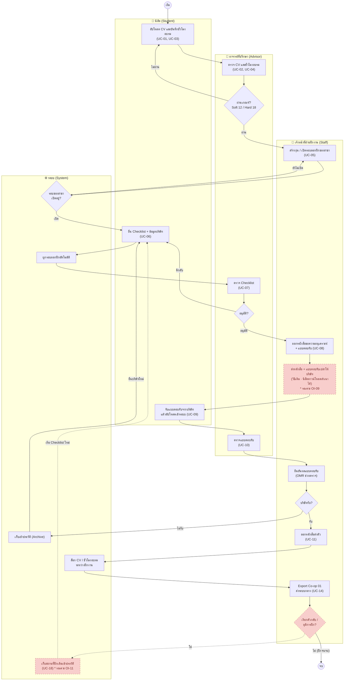

# 09 · Activity Diagram (ขั้นตอนการทำงานหลัก)

> ขั้นตอนตั้งแต่ **เตรียมความพร้อม → ออกหนังสือส่งตัว → Export Co-op 01** แยกตามผู้รับผิดชอบ
> ไฟล์ที่แก้ไขได้ (แบบแบ่งเลนตามผู้ใช้ / Swimlane): [activity_main_flow.drawio](activity_main_flow.drawio)

## แผนภาพ

## คำอธิบายขั้นตอน

| ลำดับ | ผู้รับผิดชอบ | ขั้นตอน | กฎที่เกี่ยวข้อง |
|:---:|---|---|---|
| 1 | นิสิต | อัปโหลด CV และบันทึกชั่วโมงอบรม | BR-10, BR-11 |
| 2 | อาจารย์ที่ปรึกษา | ตรวจ CV และชั่วโมงอบรม — ไม่ผ่านให้สะสมเพิ่ม/แก้ไข | BR-11 |
| 3 | เจ้าหน้าที่ | สร้างรุ่นและเปิดรอบของสาขา — ถ้ายังไม่เปิด นิสิตยังยื่นไม่ได้ | BR-20, BR-21 |
| 4 | นิสิต + ระบบ | ยื่น Checklist ทีละ 1 บริษัท ระบบผูกรอบออกฝึกให้อัตโนมัติ | BR-24, BR-30 |
| 5 | อาจารย์ที่ปรึกษา | อนุมัติ หรือตีกลับให้นิสิตแก้ไข | BR-32 |
| 6 | เจ้าหน้าที่ | ออกหนังสือขอความอนุเคราะห์ (รวมรายบริษัทได้) | BR-40 |
| 7 | เจ้าหน้าที่ 🔴 | ส่งหนังสือและแบบตอบรับเปล่าให้บริษัทตามวิธีเดิม นิสิตดาวน์โหลดสำเนาได้ — ช่องทางส่งยังรอเคาะ | BR-49 · [OI-09](../04_OPEN_ISSUES.md#oi-09) |
| 8 | นิสิต → อาจารย์ → เจ้าหน้าที่ | อัปโหลดแบบตอบรับ → ตรวจ → ยืนยัน (OMR ช่วยตรวจ) | BR-41 |
| 9 | เจ้าหน้าที่ / ระบบ | บริษัทรับ → หนังสือส่งตัว · ไม่รับ → เก็บประวัติแล้วยื่นใหม่ | BR-42 |
| 10 | ระบบ | ล็อก CV/ชั่วโมงอบรมระหว่างฝึกงาน | BR-14 |
| 11 | เจ้าหน้าที่ | Export Co-op 01 ส่งระบบกลาง — จบขอบเขตระบบ | BR-60 |
| 12 | เจ้าหน้าที่ / ระบบ 🔴 | ระหว่างฝึกถูกเรียกตัวกลับหรือบริษัทส่งตัวคืน → เก็บสถานที่ฝึกเดิมเข้าประวัติ แล้วเริ่ม Checklist ใหม่ (แนวโน้ม) | BR-56 · [OI-11](../04_OPEN_ISSUES.md#oi-11) |

> 🔴 **กรอบเส้นประสีแดง** = ขั้นตอนที่ยังรอเคาะในที่ประชุม (OI-09, OI-11)
>
> **รอบที่ 2** (ไม่แสดงในแผนภาพนี้): ฝึกที่เดิมเริ่มที่ขั้นที่ 6 · เปลี่ยนที่ใหม่เริ่มที่ขั้นที่ 4 (BR-52, BR-53)
