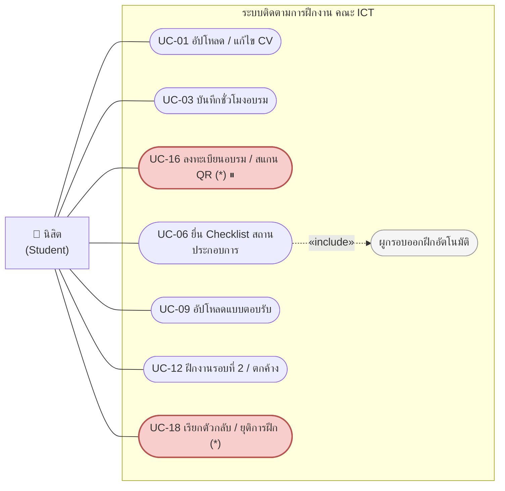
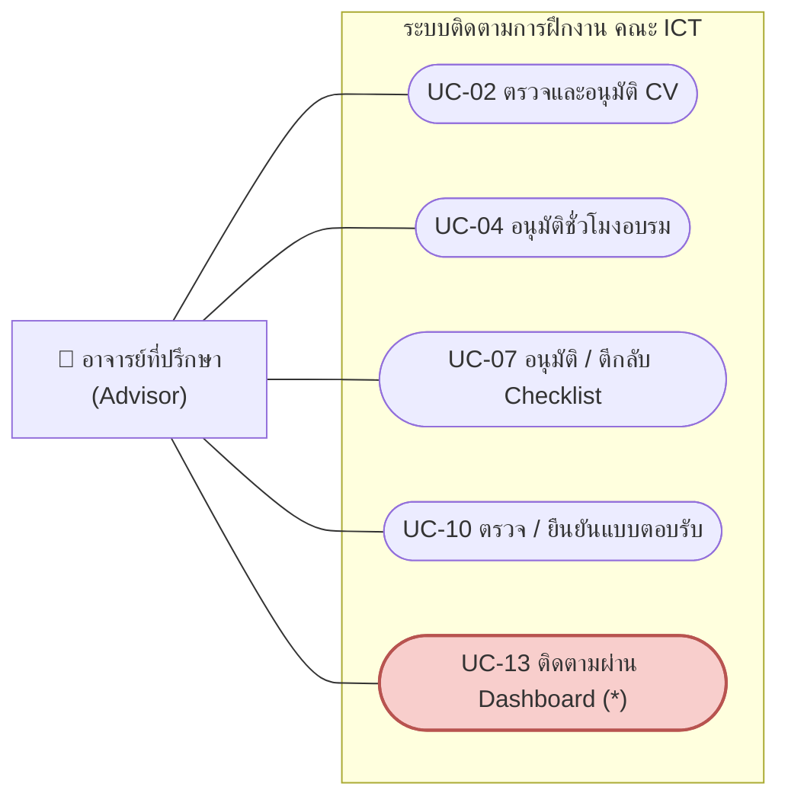
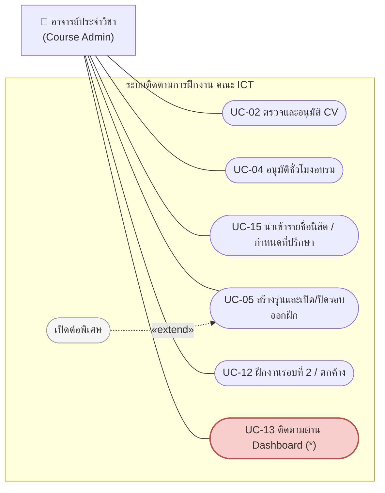
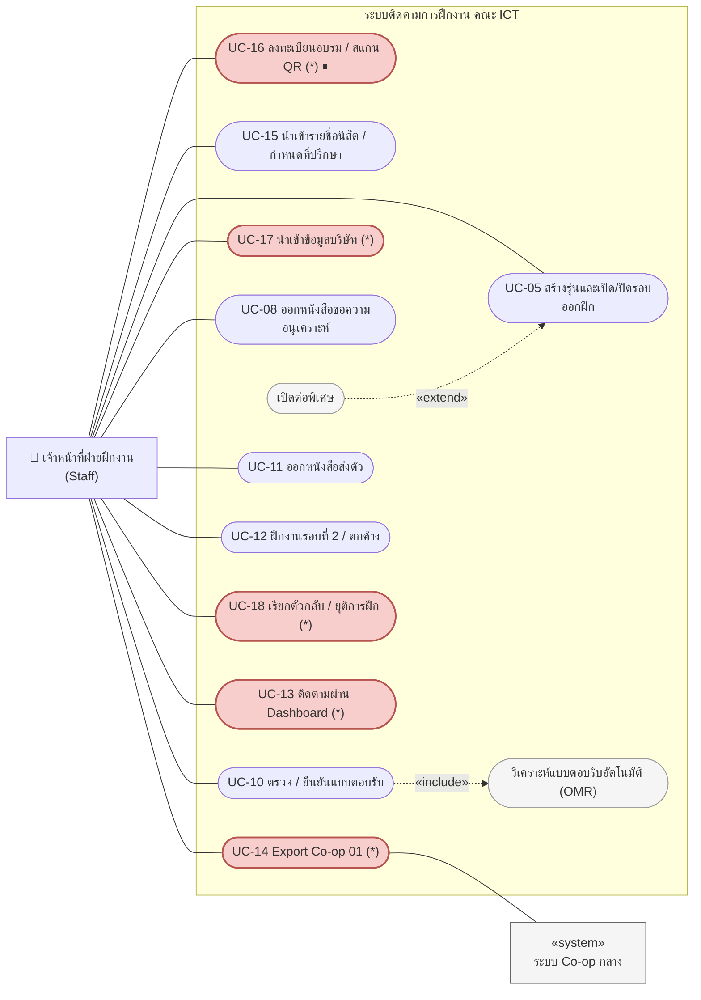
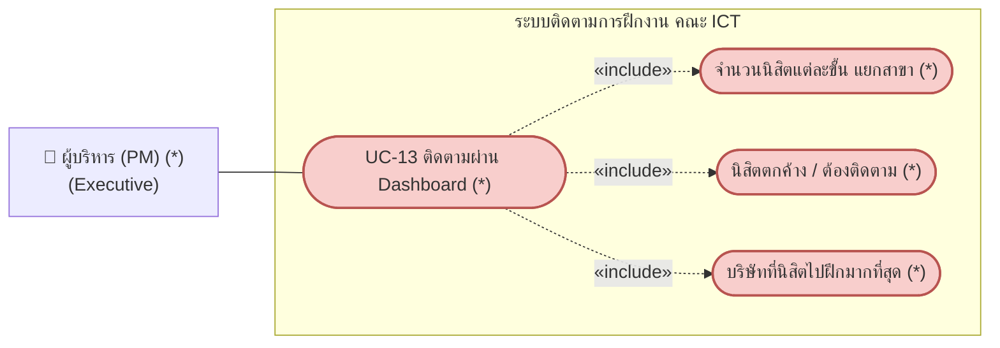

# 10 · Use Case Diagram แยกตามบทบาท (Use Case by Role)

> แยกจากแผนภาพรวม [05_USE_CASE_DIAGRAM.md](05_USE_CASE_DIAGRAM.md) ให้เหลือ **1 ภาพต่อ 1 บทบาท** เพื่อให้อาจารย์แต่ละท่านตรวจเฉพาะส่วนของตัวเองได้ง่าย
> คำถามสำหรับวันประชุม: **"บทบาทของอาจารย์ทำสิ่งเหล่านี้ครบหรือไม่ ขาดหรือเกินอะไร"**
> ไฟล์แก้ไข / Export: `use_case_role_student.drawio`, `use_case_role_advisor.drawio`, `use_case_role_course_admin.drawio`, `use_case_role_staff.drawio`, `use_case_role_executive.drawio`

| บทบาท | จำนวน Use Case | รอเคาะ (\*) | ไฟล์ .drawio |
|---|:---:|:---:|---|
| [นิสิต](#student) | 7 | 2 | [use_case_role_student.drawio](use_case_role_student.drawio) |
| [อาจารย์ที่ปรึกษา](#advisor) | 5 | 1 | [use_case_role_advisor.drawio](use_case_role_advisor.drawio) |
| [อาจารย์ประจำวิชา](#course-admin) | 6 | 1 | [use_case_role_course_admin.drawio](use_case_role_course_admin.drawio) |
| [เจ้าหน้าที่ฝ่ายฝึกงาน](#staff) | 11 | 5 | [use_case_role_staff.drawio](use_case_role_staff.drawio) |
| [ผู้บริหาร (PM) (\*)](#executive) | 1 (+3 ข้อเสนอ) | 1 | [use_case_role_executive.drawio](use_case_role_executive.drawio) |

**วิธีอ่าน:** วงรีขาว = ทำได้แล้ว · สีแดง (\*) = รอเคาะในที่ประชุม · เส้นประ = Use Case ย่อย («include» ทุกครั้ง / «extend» บางกรณี)

---

## 1. นิสิต (Student)

**ประเด็นที่ต้องเคาะ:** [OI-02](../04_OPEN_ISSUES.md#oi-02) ลงทะเบียนอบรม / QR · [OI-09](../04_OPEN_ISSUES.md#oi-09) นิสิตนำส่งหนังสือเองได้หรือไม่ · [OI-11](../04_OPEN_ISSUES.md#oi-11) ถูกเรียกตัวกลับ · [OI-13](../04_OPEN_ISSUES.md#oi-13) รุ่นใหม่เริ่มยื่น Checklist เมื่อไร

## 2. อาจารย์ที่ปรึกษา (Advisor)

**ประเด็นที่ต้องเคาะ:** [OI-06](../04_OPEN_ISSUES.md#oi-06) ช่องทางแจ้งเตือน · [OI-14](../04_OPEN_ISSUES.md#oi-14) นิสิตตกค้างเปลี่ยนอาจารย์ที่ปรึกษาหรือไม่ · [OI-04](../04_OPEN_ISSUES.md#oi-04) อาจารย์นิเทศก์ยังต้องมีหรือไม่

## 3. อาจารย์ประจำวิชา (Course Admin)

**ประเด็นที่ต้องเคาะ:** [OI-01](../04_OPEN_ISSUES.md#oi-01) เกณฑ์หรือข้อยกเว้นรายสาขา · [OI-03](../04_OPEN_ISSUES.md#oi-03) เห็นเฉพาะสาขาตัวเองหรือทั้งคณะ · [OI-14](../04_OPEN_ISSUES.md#oi-14) ใครเป็นผู้เปลี่ยนอาจารย์ที่ปรึกษา

## 4. เจ้าหน้าที่ฝ่ายฝึกงาน (Staff)

**ประเด็นที่ต้องเคาะ:** [OI-09](../04_OPEN_ISSUES.md#oi-09) เลขที่หนังสือ / กำหนดเวลา / ช่องทางส่ง · [OI-10](../04_OPEN_ISSUES.md#oi-10) แบบฟอร์มแบบตอบรับ · [OI-12](../04_OPEN_ISSUES.md#oi-12) ลายเซ็นรองคณบดีแบบสแกน · [OI-15](../04_OPEN_ISSUES.md#oi-15) นำเข้าข้อมูลบริษัท · [OI-02](../04_OPEN_ISSUES.md#oi-02) ลงทะเบียนอบรม / QR · [OI-07](../04_OPEN_ISSUES.md#oi-07) รูปแบบไฟล์ส่งระบบกลาง

## 5. ผู้บริหาร (PM) (\*)

**ประเด็นที่ต้องเคาะ:** [OI-04](../04_OPEN_ISSUES.md#oi-04) ต้องการเห็นตัวเลขอะไร และต้องมีหน้าแยกหรือไม่ (3 ข้อในภาพเป็นข้อเสนอของทีม) · [OI-05](../04_OPEN_ISSUES.md#oi-05) สาขาที่เข้าร่วมระบบ
